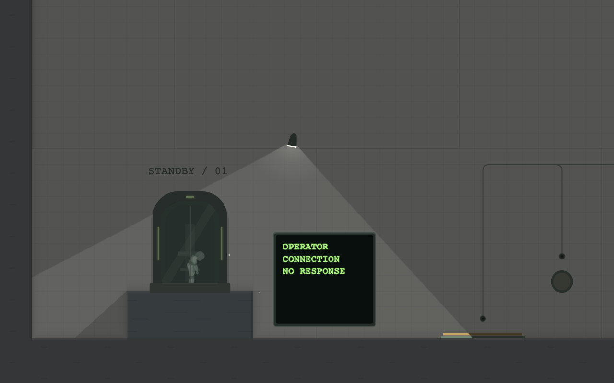
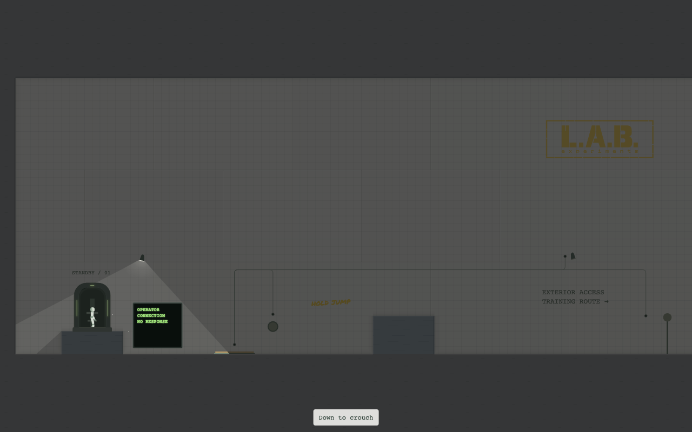
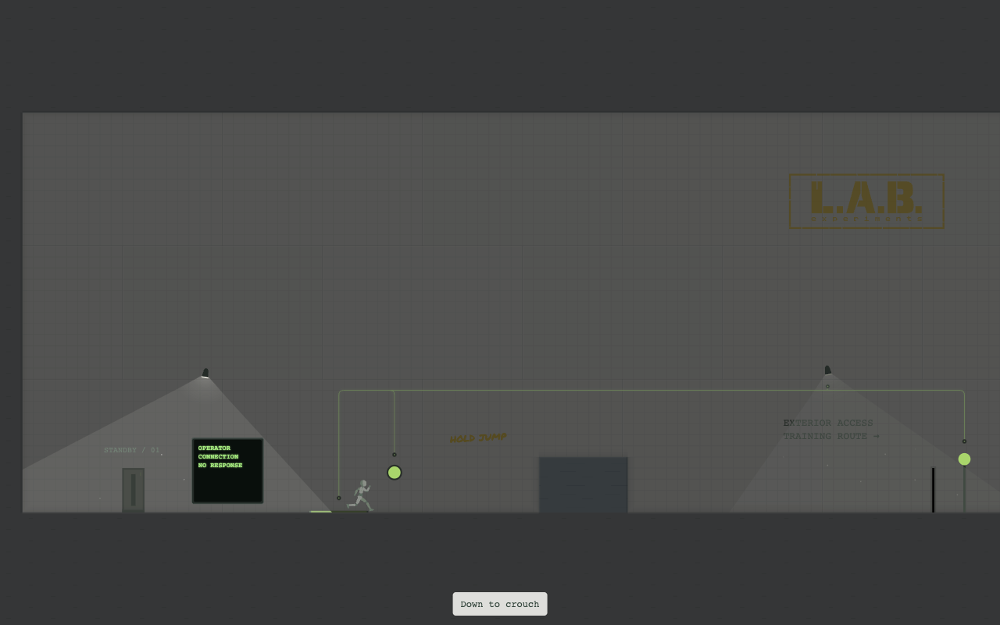

# L.A.B. Experiments: canon and campaign

**Canon and approved design direction — October 18, 2026.**

Progression revised October 20, 2026: letter grades, a D passing deadline,
and undisclosed locked courses replace completion-only progression.

Presentation revised November 1, 2026: the campaign is played inside the
facility. Connected hub wings with course doors replace the level grid, course
records move onto in-world placards and an evaluation board, and the
evaluation's release leads into an ungraded escape route.

This is the story and progression authority for L.A.B. Experiments (Leaps and
Bounds). Read it with [Making a fun jumping level](jumping-level-design.md),
[level files](jumping-levels.md), [the outdoor finale brief](jumping-outdoors.md),
and [the facility design spec](jumping-facility.md).
The canon and rules below are adopted. The built-in untimed opening, Wake,
implements the charging-bay awakening. The final Spelunk sequence supplies the
outdoor ending. The level grid currently implements D-or-better progression;
the facility wings, in-world records and ungraded escape route that replace it
are adopted but not yet built. Optional certification gates and independent
campaign-wide playtesting also remain.

## Canon

L.A.B. trained general-purpose autonomous robots to work in the human world.
Its training areas reproduce mobility, freight handling, construction,
maintenance, water access, and other practical problems. The facility evaluates
adaptability: different sound solutions are legitimate. Its physical training
equipment explains the crates, balls, plates, lifts, ropes, coins, and clocks.
Coins are course targets and counters, not a surviving economy.

A societal collapse interrupted that work. The staff left, ordinary access was
sealed during shutdown, and no one returned. Automatic systems continued on
intermittent surviving power. The facility has been empty long enough for
neglect, flooding, and plant growth to change it.

An automatic power-recovery cycle restores one occupied charging bay and wakes
the robot left there. The robot receives no answer from its operator. Its
autonomy allows it to form a goal of its own: leave the facility and discover
what remains outside. It was left behind; its awakening does not establish a
chosen-one role or a secret rescue assignment.

Staff passages and freight exits are sealed or unusable. The surviving connected
route follows the training circuit through every required area. Completed
exercises release the next boundary. The building still applies its procedures
to a robot whose reason for using them has changed.

The training circuit is a real place. Corridors and halls connect the course
doors, as they once moved units between exercises, and the robot walks them.
The facility's automatic evaluation still runs. It records each unit's results
at the course doors and, once every required course is passed, releases the
unit for dispatch through the exterior freight route. That route has failed.
The procedure ends at a door that opens onto collapse, and from there the robot
finds its own way out: up the climb, down through the caves, and outside. The
evaluation is the facility's goal; leaving is the robot's.

Shovebots and other operating machines retain narrow jobs and routines. Their
behavior follows existing gameplay rules. Facility automation can be dry,
helpful, or absurdly out of date. Its continued procedure supplies much of the
humor and melancholy.

The robot ultimately escapes. The outside has weather, natural ground, distant
space, and living vegetation. Human civilization's fate remains uncertain;
the world visibly continues. The ending resolves the robot's chosen goal while
leaving its next destination open.

### What remains deliberately unresolved

The exact cause and date of the collapse, the fate of individual staff, and
whether people or other autonomous robots survive elsewhere are not fixed.
Environmental clues may suggest these questions without settling them. New
levels must not quietly establish a war, an AI uprising, a named catastrophe,
or a precise elapsed time as fact. Avoid mandatory lore explanations of the
protagonist's inner life; the player's actions carry its growing agency.

## Storytelling and level identity

Every campaign level needs an original training purpose, a present condition,
and a place in the journey. Show those through architecture and usable objects.
Mobility courses may be openly artificial; work simulations should suggest
their intended activity. An intact early course and a later damaged service
room need not have the same amount of deterioration.

Official labels and L.A.B. marks describe the facility's intended operation.
Brief red graffiti is human maintenance advice, frustration, or observation.
It can help the robot now without implying that someone recently anticipated
this particular escape. Use existing markings and the restrained material
palette. Abandoned work and changes in access tell more than repeated lore
paragraphs. Understanding the route must not depend on optional reading.

Keep the game's nonlethal recovery, playful physics, and alternative solutions.
Flooding and broken access create decisions using established mechanics;
story damage must not introduce unreliable collisions or one-off physics rules.
Replays are gameplay affordances and need no literal time-reset explanation.

Course equipment stays in courses. Coins, coin switches, wall clocks and time
pickups are the facility's scoring layer, closer to virtual targets than
physical objects, so they exist only in timed courses. Wings and the escape
route use physical mechanisms only: plates and switches, gates, lifts and
platforms, water and float switches, gravity plates, force fields, wiring and
cargo.

## Presenting the campaign in the world

Everything the player reads during the campaign is something the robot could
look at: wall clocks, terminals, course door placards, the evaluation board,
destination signs, labels and graffiti. A grid of level tiles, result dialogs
and Next buttons present a person choosing levels at a computer, so the
campaign does not use them. Course progress is shown where the courses are.

The lasting exceptions are the pause screen, the controls reference, storage
notices and arcade navigation. Present the pause screen as the robot's own
system display, in the terminals' green phosphor, never as a facility screen.
The closing card after the bus departs is also an exception: the robot has
left, and nothing remains for it to look at. Every in-world display has an
equivalent screen-reader announcement.

Wings follow Hard Vacuum's restraint. Wall text is limited to destination signs,
course placards, industrial labels and brief graffiti, with no floating prompts,
tutorial cards or objective paragraphs. Lit doors and open passages make the
route readable without reading anything.

## Campaign shape

The main campaign is a fixed, curated set of required courses with a clear
beginning and ending. Every required course must be passed to reach the escape.
The current built-in catalog is a pool to review and order, not an already
validated campaign. Assign levels deliberately; do not infer story membership
from filenames or make every future built-in mandatory automatically.

The facility is one connected building that the robot explores freely, in the
manner of a metroidvania. A central concourse holds the evaluation board and
the sealed exterior dispatch door, visible from the first visit. Wings open off the concourse. Each wing houses one training discipline
(movement, freight, construction, water, security and so on), groups the
courses of that discipline behind its doors, and has its own look: palette,
lighting, signage, machines and sound. A sense of place matters more than
variety within a wing; the player supplies variety by moving between open wings.
Each wing's courses rise in difficulty from its entrance to its far end, where
the building is also in the worst condition. Shortcuts opened from deep inside
a wing loop back to the concourse, so moving between wings stays easy.

Wings themselves are untimed and ungraded. They carry light traversal of their
own and never feel like test courses: they are the building between the tests,
with sealed staff doors, abandoned work, and failures that grow with depth. A
course returns the robot to its own door. Course names appear on door placards,
so every course needs a name that works as facility signage.

Access is gated, not ability. The robot's movement never changes, because every
course is tuned for its full repertoire; carried gadgets stay inside the
courses that provide them. Wings open through clearance: a wing's bulkhead
opens once named courses elsewhere are passed, and its placard shows how many
remain.

| Phase | Place | Player experience | Environmental development |
| --- | --- | --- | --- |
| Wake | Charging bay | Discover movement, the empty bay, and the need to find a way out. | Local power returns; requests for an operator go unanswered. |
| Orientation | One untimed level: charging room, training hall, Company's cave | Wake, learn the basic controls with safe recovery, then meet the first response unit and escape it. | Intact course labels explain what the facility used to do; "not everyone left". |
| Working wings | Discipline wings, in parallel | Combine known skills and choose where to go next. | Unfinished jobs and maintenance markings reveal abandonment. |
| Deterioration | Deep ends and late wings | Adapt known skills around visible failures. | Flooded basins, damaged access, and surviving machinery change the exercises and the corridors between them. |
| Release | Escape route | Leave the evaluation behind; after the final course, the climb and caves are untimed and ungraded. | The released freight route has collapsed; the robot improvises its own way. |
| Outside | Exit | Restore the final route, cross the threshold, and explore a short exterior. | Enclosure gives way to open sky, a natural horizon, and a continuing world. |

These are pacing phases, not a requirement for equal wing sizes. Within a wing,
keep brief, confident movement courses between demanding puzzles. Optional
advanced areas branch from this structure and return to it, through
certification doors in the wings. Local, account, community, stress,
and experimental collections remain available for their own purposes, and the
level grid remains as the development library; campaign locks must not obstruct
editing or playtesting.

## Required progression

1. The opening, Orientation, is available on a new save. It is one untimed
   level: Wake's night-lit charging room, a day-lit training hall that teaches
   the basic controls in a fixed order (jump, gap jumps, plates, the rope), and
   Company's dark cave, where the first response unit wakes and the robot climbs
   out ahead of it. Its exit opens onto the concourse, and every wing opens off
   the concourse.
2. Each wing's courses form a fixed sequence. Finishing a timed required course
   at D or better unlocks the next course in its wing and lights its door. D is
   a realistic first-run deadline, not a free pass. An untimed level unlocks
   its successor on completion. Coin surplus, optional-area completion,
   and total campaign average cannot add a requirement. Wings open by clearance,
   and the order in which the player works through open wings is theirs.
3. Completion is recorded at the level's actual finish, after its completion
   presentation. Merely powering an exit or reaching a nearby switch is not a
   completion. Ordinary levels retain their current doorway-entry scoring.
4. Unlocked courses remain available for replay through their doors. Slower runs
   never reduce grades, remove completion, or relock areas. Optional diversions
   never delay the next required unlock. A new game starts in Orientation's
   charging pod. Orientation keeps a door on the concourse, like every other
   level; re-entering through it starts at the level's far end, beside Service
   access. Afterward, starting the game resumes where the robot was
   last autosaved.
5. The evaluation completes when every required course is passed. Its release
   opens the escape route, whose levels are untimed. Escaping completes the
   campaign; no grade above D is required for the ending.

The evaluation board shows every required course as a numbered lamp, grouped
by wing in each wing's order. A locked course's lamp and door stay dark: no
name, grade or time until it unlocks. An unlocked door's placard shows the course name, its D
deadline, and once passed, the best time and best grade. Unlocking, passing and
improving a course update its placard and lamp where the robot can see them.
The authoring library and playtests remain unrestricted. Direct play links also
respect progression. Use stable level IDs for progress. Older saved times count
when they meet the current D deadline; an older completion flag alone cannot
prove a timed pass. Untimed completion remains saved independently of best time.
Doors, lamps and bulkheads are derived from these records. The only new saved
value is the robot's autosaved place: the hub and the door it came through,
the door of the course it is playing, or its escape level. Wake's pod is the
game's only charging bay; the facility has no save points to visit.

The wall clock counts down to the D deadline while showing the current A/B/C/D
grade. Passing D permanently makes that run F: the timer dims at zero and time
pickups turn grey and cannot be collected. The player may continue exploring,
operate mechanisms, collect coins and use gadgets, but must restart to progress.
Reaching the exit on F records the time and grade without awarding a passing
completion or unlocking the next course. Back in the wing, the placard shows
the failed run, and the next door stays dark.

## Optional advanced areas

An advanced area opens when its named source group is complete with an average
of at least B. Source groups are fixed, nonempty sets of timed required
levels, normally the courses of the wing where its door stands. Identify the
group and its members before the player attempts to qualify. Untimed story
sequences, the escape route, the outdoor coda, and optional levels are excluded. No area can depend on its own grades.

Use each source level's highest earned grade, counting the level once:

| Best grade | Points |
| --- | ---: |
| D | 0 |
| C | 1 |
| B | 2 |
| A | 3 |

For a source group of `N` levels, the gate opens when **all N are completed**
and **the sum of best-grade points is at least `2 * N`**. Compare integer totals;
do not round an average or average completion times. A compensates for
C, and sufficiently many A grades can compensate for a D. Repeating one level cannot farm points.

For example, A + B + C gives `3 + 2 + 1 = 6` across three completed
levels and opens the area. B + B + C gives 5 and needs one more
point. An incomplete level always prevents certification, regardless of points.

A certification door's placard shows the source group, completion count, best
grades, and point shortfall: “COMPLETE ALL 3 COURSES. CERTIFICATION 5 / 6.”
It explains that improving C to B or B to A adds one point. The requirement must
be understandable without calculating a hidden campaign-wide average.

Once earned, access is permanent. Later runs, threshold retuning, and catalog
additions cannot revoke it. Keep the best earned grade and earned access
durable; changing a source group must not silently invalidate past awards.
Advanced areas offer extra challenges and optional discoveries. They contain
no required escape switch, unique traversal ability, or indispensable story
explanation. The full outdoor payoff belongs to every campaign finisher.

Before enabling a certification group, calibrate its grades against completed
normal-control routes with the current movement rules. Historical timings do
not establish that an average B requirement is fair after control changes.

## Opening: Wake

Central idea: a robot restores enough awareness and local access to begin
searching an empty training facility.

Begin in an installed charging or diagnostic bay. Power returns locally, the
robot awakens, and control passes promptly to the player. A failed operator
connection and visible training-route signage establish the situation. Suggested
brief display copy is “OPERATOR CONNECTION LOST” and “EXTERIOR ACCESS: TRAINING
ROUTE”; the wording may be refined during layout review.

Teach movement through one small, recoverable action and let the player discover
the empty adjoining space. The required route should be legible without waiting
for a message or standing through repeated diagnostics. A small optional look
around may reward curiosity. The opening has no medal pressure or required
collectibles. In Orientation its power plate opens the training access gate,
letting the training hall's daylight into the room.

The first implementation is [Wake](../public/levels/jumping/Wake.jump-level.json),
placed first in the built-in collection. Keep it simple, beautiful, and a little
spooky: Night mode, one occupied charging bay, a failing work light, a small
operator terminal, and sparse installed hardware. The terminal reads “OPERATOR
CONNECTION / NO RESPONSE” in dim green phosphor. Its lettering stays readable
when the light cuts out. The occupied pod has a substantial rounded shell,
a recessed cradle, and a split glass cover. It stands on a low steel plinth;
the robot begins inside the pod on that support and its first movement is a
small hop down to the room floor. The glass and front sill overlap the robot,
so its sleeping silhouette reads as enclosed within the cradle. A closer
initial view holds on the sleeping robot: quiet green power returns, its head and shoulders rise using
the existing rig, and the cover releases. The camera gently reveals the room
within the 3.6-second awakening before control passes to the player. There is no
introductory door sequence, timer, medal, required collectible, or new bitmap.

One broad latching floor switch restores the access light and training-route
exit. Optional thin wall wires with small, separate terminals make those
relationships visible. After the small hop down from the pod, the room floor
provides a clear route and easy recovery. Missing the switch allows a readable return. Avoid
adding more puzzles, props, lore panels, or dramatic effects before reviewing
this small room at normal speed.

Charging-bay entrances and untimed levels are reusable studio choices with
pause, restart, automatic input handoff, and saved completion. Ordinary levels
retain their doorway entrance and scoring. Completing Orientation opens the
concourse; from there, timed courses require D or better to light the next
door.

Initial review verified a fresh-start browser keyboard completion, including
recovery from a ledge catch using Up. Automated normal-control routes cover
running and slower approaches, and a separate control replay verified returning
after jumping past the power switch. Browser checks cover paused awakening,
restart, untimed completion and reload, studio undo/save/reopen, and landscape
and portrait rendering. Message-screen checks cover editing and persistence,
readable phosphor in darkness, an unlit surrounding wall, and occlusion behind
terrain in both lighting backends. Thin wires end at separate wall terminals,
turning quiet green with a subtle Night-mode glow when their source sends power,
and returning to soft gray-green during EMP.
Physical-controller and actual-phone feel, and an
independent review of the opening's mood and enjoyment, remain unverified.

## Company: the other awakening

Company echoes Wake with the facility's one recurring response robot. The
player enters under the rock overhang and discovers a wider occupied capsule
on a steel mounting plinth. A matching unanswered operator terminal links the
two awakenings; brief human graffiti suggests someone else was left behind.
The response unit wakes through real sight, noise or contact, then leaves its
empty cradle and hunts normally. Control never leaves the player during this
local awakening. The pod supplies no invisible containment.

Night lighting separates the failing service approach, occupied bay and upper
escape gantry. Preserve the authored cave, loose cargo and exposed rope climb.
The optional carried EMP on the service approach offers a way to interrupt the
hunter; cargo still absorbs its bolt, so a clear firing position matters.
The intended encounter remains a short escape, without an added coin sweep or
sequence of switches. Pod installation is a reusable Repulsorbot inspector
option, not a Company-specific runtime script.

Normal-control simulation replays completed the unarmed escape in 15.6 seconds,
the EMP approach in 16.7, and a missed-rope recovery under pursuit in 24.7.
Current A/B/C/D deadlines are 18/28/42/65 seconds. A fresh browser keyboard
playthrough also completed the unarmed rope escape, with rendered checks of the
sleeping capsule, awakening, pursuit and exit. These checks do not establish
physical-controller or actual-phone feel.

## Finale: Outside

Central idea: apply learned skills to restore the last service route, then
experience the world beyond the training facility under the player's control.

The service approach combines a few established skills with generous recovery.
It introduces no mandatory new mechanic or unusually severe precision test.
The final exterior threshold reveals a broad sky and natural landscape. After
crossing it, the player gets a short, untimed outdoor journey with room to stop,
look back, and continue. An ordinary accessible line and a playful faster line
can share this ground. The final departure establishes that the facility has
been left behind and a larger world lies ahead.

Follow the [outdoor terrain, sky, staging, and acceptance brief](jumping-outdoors.md).
Reserve the first full landscape for this moment. Optional certification must
never buy a larger, clearer, or more complete version of the ending.

Separate the restored exterior service gate from the level's scoring finish.
It must not trigger the current doorway result dialog before the outdoor walk.
If the service approach is timed, latch its score at the exterior threshold,
then enter an untimed playable coda; record the final level and campaign as
complete only at the authored outdoor endpoint. The endpoint needs an explicit
finish presentation, without putting another training door in the meadow.
Provide a clear finish action or boundary, allow the player to linger before
it, and retain the last safe exterior checkpoint when resuming the coda.
Version-2 landscapes and the untimed `walk-off` finish now provide this path.
The authored finale is untimed throughout, so there is no score to latch at
the threshold. Timed approaches with a separately latched coda score remain
future work. Play and reload start at the authored entrance; the pause menu's
Resume keeps the current run. The waiting bus is Exit's actual goal, visible
during the normal outdoor approach. The player retains control and walks aboard
through its left-side entrance. Boarding completes the level and saves progress;
no edge crossing, automatic approach, or camera reveal is needed. Leave a broad
flat walk between the final landing and the stop, so the player can see the bus
and approach it deliberately. The bus departs in the same level view.
The implied road crosses the platforming plane, and we see the bus from behind.
Keep the landscape flat, without a drawn road surface or perspective lines. The
robot boards around its side, then becomes visible seated in the rear window.
Hold this quiet moment before the bus drives directly away from the camera,
shrinking about a fixed visual center until the wheel bottoms align with the
flat ground line. It then lowers behind that line while continuing to shrink,
wheels first and roof last. There is no upward journey or
separate elevated horizon. Draw no hill or rise.
Keep the artwork in the game's flat 2D style. Pause and skip remain available,
and the result panel follows the departure. The empty stop remains behind the panel.
This quiet, ordinary journey is the ending payoff; it adds no new playable
challenge or explanation of the outside world. Overlook finishes remain
available for other levels.

The current closing sequence is **Ascent I → Ascent II → Spelunk → Exit**.
It begins at the dispatch door the evaluation releases. The leading option,
still to be settled, keeps Ascent I as the final timed course: the facility's
last test, behind the dispatch door, whose exit opens into Ascent II instead of
returning to a wing. From Ascent II on, the levels are the robot's own route,
not courses: untimed, with no placards, grades or doors back into the circuit,
and each one's exit leads directly into the next. Making a level untimed is a
redesign, not a setting: anything that relied on the clock or on coins must be
rebuilt from physical mechanisms. Preserve the Ascent levels' climb toward
escape. The caves supply the last detour beneath the
blocked surface route; Exit leads through the final climb, emergence and
overworld journey. The [earlier escape route evidence and remaining
review](jumping-escape-review.md) retain the previous Spelunk II/III layouts.

## Delivery and review

Review the catalog for intended teaching order, wing membership, course names,
and repeated ideas before assigning the required sequence or certification
groups. Preserve authored files and IDs. Specify campaign metadata and
persistence separately from runtime level geometry. This brief establishes no
schema keys; the [facility design spec](jumping-facility.md) proposes them.

Acceptance requires fresh-save progression through the full required route,
including D passes and F exploration runs; below-threshold and exactly-threshold optional
gate checks; permanent unlocks across replay and reload; existing-save migration;
and confirmation that skipping every advanced area still delivers the complete
escape. Verify direct navigation and all supported control paths obey campaign
locks while studio playtests remain usable. Every unlocked door must be
reachable from where the game places the robot, using normal controls and only
skills taught before that door; walking past a door must never enter it.

Opening and finale review must include normal-speed play, pause/restart/resume,
story readability without mandatory wall reading, comfortable recovery, and
the complete outdoor coda. Measure actual runs before setting any medal times.
File checks and automated routes do not establish emotional payoff or enjoyment.
