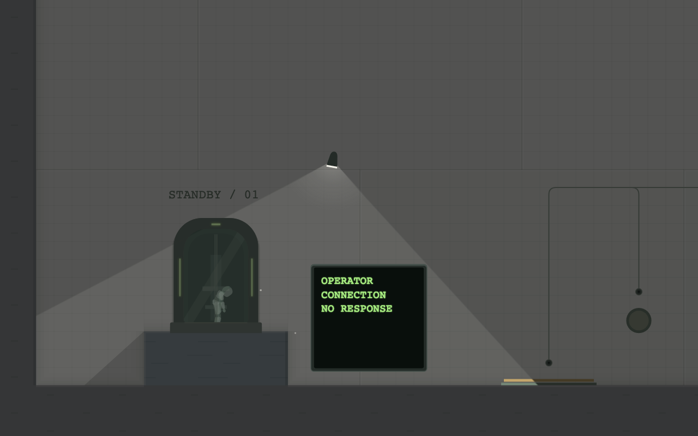
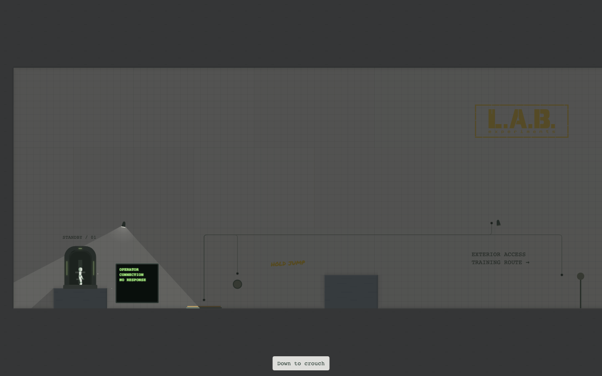
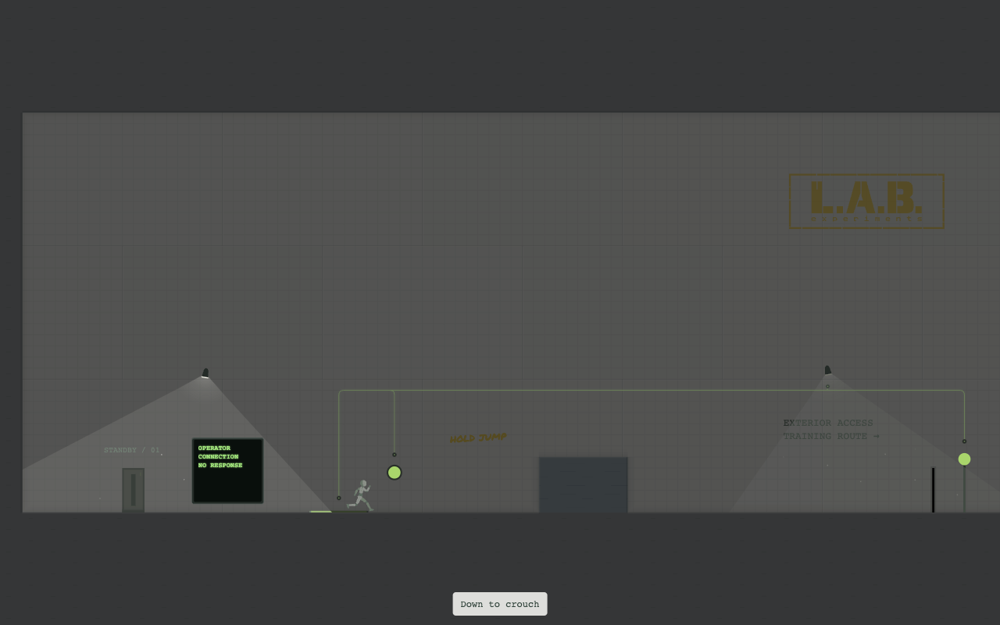

# L.A.B. Experiments: canon and campaign

**Canon and approved design direction — October 18, 2026.**

Progression revised October 20, 2026: letter grades, a D passing deadline,
and undisclosed locked courses replace completion-only progression.

This is the story and progression authority for L.A.B. Experiments (Leaps and
Bounds). Read it with [Making a fun jumping level](jumping-level-design.md),
[level files](jumping-levels.md), and [the outdoor finale brief](jumping-outdoors.md).
The canon and rules below are adopted. The built-in untimed opening, Wake,
implements the charging-bay awakening. The ordered picker now uses D-or-better
progression; optional certification gates and the outdoor ending still need
implementation and playtesting.

## Canon

L.A.B. trained general-purpose autonomous robots to work in the human world.
Its training areas reproduce mobility, freight handling, construction,
maintenance, water access, and other practical problems. The facility evaluates
adaptability: different sound solutions are legitimate. Its physical training
equipment explains the crates, balls, plates, lifts, ropes, coins, and clocks.
Coins are course targets and counters, not a surviving economy.

A societal collapse interrupted that work. The staff left, ordinary access was
sealed during shutdown, and no one returned. Automatic systems continued on
intermittent surviving power. The facility has been empty long enough for
neglect, flooding, and plant growth to change it.

An automatic power-recovery cycle restores one occupied charging bay and wakes
the robot left there. The robot receives no answer from its operator. Its
autonomy allows it to form a goal of its own: leave the facility and discover
what remains outside. It was left behind; its awakening does not establish a
chosen-one role or a secret rescue assignment.

Staff passages and freight exits are sealed or unusable. The surviving connected
route follows the training circuit through every required area. Completed
exercises release the next boundary. The building still applies its procedures
to a robot whose reason for using them has changed.

Shovebots and other operating machines retain narrow jobs and routines. Their
behavior follows existing gameplay rules. Facility automation can be dry,
helpful, or absurdly out of date. Its continued procedure supplies much of the
humor and melancholy.

The robot ultimately escapes. The outside has weather, natural ground, distant
space, and living vegetation. Human civilization's fate remains uncertain;
the world visibly continues. The ending resolves the robot's chosen goal while
leaving its next destination open.

### What remains deliberately unresolved

The exact cause and date of the collapse, the fate of individual staff, and
whether people or other autonomous robots survive elsewhere are not fixed.
Environmental clues may suggest these questions without settling them. New
levels must not quietly establish a war, an AI uprising, a named catastrophe,
or a precise elapsed time as fact. Avoid mandatory lore explanations of the
protagonist's inner life; the player's actions carry its growing agency.

## Storytelling and level identity

Every campaign level needs an original training purpose, a present condition,
and a place in the journey. Show those through architecture and usable objects.
Mobility courses may be openly artificial; work simulations should suggest
their intended activity. An intact early course and a later damaged service
room need not have the same amount of deterioration.

Official labels and L.A.B. marks describe the facility's intended operation.
Brief red graffiti is human maintenance advice, frustration, or observation.
It can help the robot now without implying that someone recently anticipated
this particular escape. Use existing markings and the restrained material
palette. Abandoned work and changes in access tell more than repeated lore
paragraphs. Understanding the route must not depend on optional reading.

Keep the game's nonlethal recovery, playful physics, and alternative solutions.
Flooding and broken access create decisions using established mechanics;
story damage must not introduce unreliable collisions or one-off physics rules.
Replays are gameplay affordances and need no literal time-reset explanation.

## Campaign shape

The main campaign is a fixed, curated sequence of required levels with a clear
beginning and ending. Every required area must be completed to reach the escape.
The current built-in catalog is a pool to review and order, not an already
validated campaign. Assign levels deliberately; do not infer story membership
from filenames or make every future built-in mandatory automatically.

| Phase | Player experience | Environmental development |
| --- | --- | --- |
| Wake | Discover movement, the empty bay, and the need to find a way out. | Local power returns; requests for an operator go unanswered. |
| Orientation | Learn individual movement and work patterns with safe recovery. | Intact course labels explain what the facility used to do. |
| Working sectors | Combine known skills and choose between legitimate routes. | Unfinished jobs and maintenance markings reveal abandonment. |
| Deterioration | Adapt known skills around visible failures. | Flooded basins, damaged access, and surviving machinery change the exercises. |
| Outside | Restore the final route, cross the threshold, and explore a short exterior. | Enclosure gives way to open sky, a natural horizon, and a continuing world. |

These are pacing phases, not a requirement for five maps or equal chapter
lengths. Keep brief, confident movement levels between demanding puzzles.
Optional advanced areas branch from this structure and return to it. Local,
account, community, stress, and experimental collections remain available for
their own purposes; campaign locks must not obstruct editing or playtesting.

## Required progression

1. The opening is available on a new save. Completing it opens the first course.
2. Finishing a timed required level at D or better unlocks the next required
   level. D is a realistic first-run deadline, not a free pass. An untimed
   introduction unlocks its successor on completion. Coin surplus, optional-area
   completion, and total campaign average cannot add a requirement.
3. Completion is recorded at the level's actual finish, after its completion
   presentation. Merely powering an exit or reaching a nearby switch is not a
   completion. Ordinary levels retain their current doorway-entry scoring.
4. Unlocked levels remain available for replay. Slower runs never reduce grades,
   remove completion, or relock areas. Optional diversions never delay the next
   required unlock. Continue follows the next unfinished required level.
5. The final level opens after all preceding required levels are completed.
   Escaping completes the campaign; no grade above D is required for the ending.

Show every slot in the required sequence. A locked slot reveals its number and
lock status only, without the name, preview, description or play/edit actions.
The authoring library and playtests remain unrestricted. Direct play links also
respect progression. Use stable level IDs for progress. Older saved times count
when they meet the current D deadline; an older completion flag alone cannot
prove a timed pass. Untimed completion remains saved independently of best time.

The wall clock counts down to the D deadline while showing the current A/B/C/D
grade. Passing D permanently makes that run F: the timer dims at zero and time
pickups turn grey and cannot be collected. The player may continue exploring,
operate mechanisms, collect coins and use gadgets, but must restart to progress.
Reaching the exit on F records the time and grade without awarding a passing
completion or unlocking the next course.

## Optional advanced areas

An advanced area opens when its named source group is complete with an average
of at least B. Source groups are fixed, nonempty sets of timed required
levels, normally the preceding chapter. Identify the group and its members
before the player attempts to qualify. Untimed story sequences, the outdoor
coda, and optional levels are excluded. No area can depend on its own grades.

Use each source level's highest earned grade, counting the level once:

| Best grade | Points |
| --- | ---: |
| D | 0 |
| C | 1 |
| B | 2 |
| A | 3 |

For a source group of `N` levels, the gate opens when **all N are completed**
and **the sum of best-grade points is at least `2 * N`**. Compare integer totals;
do not round an average or average completion times. A compensates for
C, and sufficiently many A grades can compensate for a D. Repeating one level cannot farm points.

For example, A + B + C gives `3 + 2 + 1 = 6` across three completed
levels and opens the area. B + B + C gives 5 and needs one more
point. An incomplete level always prevents certification, regardless of points.

Show the source chapter, completion count, best grades, and point shortfall:
“Complete all 3 courses. Certification: 5 / 6 points.” Explain that improving
C to B or B to A adds one point. The requirement must be
understandable without calculating a hidden campaign-wide average.

Once earned, access is permanent. Later runs, threshold retuning, and catalog
additions cannot revoke it. Keep the best earned grade and earned access
durable; changing a source group must not silently invalidate past awards.
Advanced areas offer extra challenges and optional discoveries. They contain
no required escape switch, unique traversal ability, or indispensable story
explanation. The full outdoor payoff belongs to every campaign finisher.

Before enabling a certification group, calibrate its grades against completed
normal-control routes with the current movement rules. Historical timings do
not establish that an average B requirement is fair after control changes.

## Opening: Wake

Central idea: a robot restores enough awareness and local access to begin
searching an empty training facility.

Begin in an installed charging or diagnostic bay. Power returns locally, the
robot awakens, and control passes promptly to the player. A failed operator
connection and visible training-route signage establish the situation. Suggested
brief display copy is “OPERATOR CONNECTION LOST” and “EXTERIOR ACCESS: TRAINING
ROUTE”; the wording may be refined during layout review.

Teach movement through one small, recoverable action and let the player discover
the empty adjoining space. The required route should be legible without waiting
for a message or standing through repeated diagnostics. A small optional look
around may reward curiosity. The opening has no medal pressure or required
collectibles. Its finish releases access to the first actual course.

The first implementation is [Wake](../public/levels/jumping/Wake.jump-level.json),
placed first in the built-in collection. Keep it simple, beautiful, and a little
spooky: Night mode, one occupied charging bay, a failing work light, a small
operator terminal, and sparse installed hardware. The terminal reads “OPERATOR
CONNECTION / NO RESPONSE” in dim green phosphor. Its lettering stays readable
when the light cuts out. The occupied pod has a substantial rounded shell,
a recessed cradle, and a split glass cover. It stands on a low steel plinth;
the robot begins inside the pod on that support and its first movement is a
small hop down to the room floor. The glass and front sill overlap the robot,
so its sleeping silhouette reads as enclosed within the cradle. A closer
initial view holds on the sleeping robot: quiet green power returns, its head and shoulders rise using
the existing rig, and the cover releases. The camera gently reveals the room
within the 3.6-second awakening before control passes to the player. There is no
introductory door sequence, timer, medal, required collectible, or new bitmap.

One broad latching floor switch restores the access light and training-route
exit. Optional thin wall wires with small, separate terminals make those
relationships visible. After the small hop down from the pod, the room floor
provides a clear route and easy recovery. Missing the switch allows a readable return. Avoid
adding more puzzles, props, lore panels, or dramatic effects before reviewing
this small room at normal speed.

Charging-bay entrances and untimed levels are reusable studio choices with
pause, restart, automatic input handoff, and saved completion. Ordinary levels
retain their doorway entrance and scoring. Completing Wake opens the first
course; timed courses then require D or better to advance through the collection.

Initial review verified a fresh-start browser keyboard completion, including
recovery from a ledge catch using Up. Automated normal-control routes cover
running and slower approaches, and a separate control replay verified returning
after jumping past the power switch. Browser checks cover paused awakening,
restart, untimed completion and reload, studio undo/save/reopen, and landscape
and portrait rendering. Message-screen checks cover editing and persistence,
readable phosphor in darkness, an unlit surrounding wall, and occlusion behind
terrain in both lighting backends. Thin wires end at separate wall terminals,
turning quiet green with a subtle Night-mode glow when their source sends power,
and returning to soft gray-green during EMP.
Physical-controller and actual-phone feel, and an
independent review of the opening's mood and enjoyment, remain unverified.

## Company: the other awakening

Company echoes Wake with the facility's one recurring response robot. The
player enters under the rock overhang and discovers a wider occupied capsule
on a steel mounting plinth. A matching unanswered operator terminal links the
two awakenings; brief human graffiti suggests someone else was left behind.
The response unit wakes through real sight, noise or contact, then leaves its
empty cradle and hunts normally. Control never leaves the player during this
local awakening. The pod supplies no invisible containment.

Night lighting separates the failing service approach, occupied bay and upper
escape gantry. Preserve the authored cave, loose cargo and exposed rope climb.
The optional carried EMP on the service approach offers a way to interrupt the
hunter; cargo still absorbs its bolt, so a clear firing position matters.
The intended encounter remains a short escape, without an added coin sweep or
sequence of switches. Pod installation is a reusable Repulsorbot inspector
option, not a Company-specific runtime script.

Normal-control simulation replays completed the unarmed escape in 15.6 seconds,
the EMP approach in 16.7, and a missed-rope recovery under pursuit in 24.7.
Current A/B/C/D deadlines are 18/28/42/65 seconds. A fresh browser keyboard
playthrough also completed the unarmed rope escape, with rendered checks of the
sleeping capsule, awakening, pursuit and exit. These checks do not establish
physical-controller or actual-phone feel.

## Finale: Outside

Central idea: apply learned skills to restore the last service route, then
experience the world beyond the training facility under the player's control.

The service approach combines a few established skills with generous recovery.
It introduces no mandatory new mechanic or unusually severe precision test.
The final exterior threshold reveals a broad sky and natural landscape. After
crossing it, the player gets a short, untimed outdoor journey with room to stop,
look back, and continue. An ordinary accessible line and a playful faster line
can share this ground. The final overlook establishes that the facility has
been left behind and a larger world lies ahead.

Follow the [outdoor terrain, sky, staging, and acceptance brief](jumping-outdoors.md).
Reserve the first full landscape for this moment. Optional certification must
never buy a larger, clearer, or more complete version of the ending.

Separate the restored exterior service gate from the level's scoring finish.
It must not trigger the current doorway result dialog before the outdoor walk.
If the service approach is timed, latch its score at the exterior threshold,
then enter an untimed playable coda; record the final level and campaign as
complete only at the authored outdoor endpoint. The endpoint needs an explicit
finish presentation, without putting another training door in the meadow.
Provide a clear finish action or boundary, allow the player to linger before
it, and retain the last safe exterior checkpoint when resuming the coda.
These capabilities require implementation; current JSON does not supply them.

## Delivery and review

Review the catalog for intended teaching order, chapter membership, and repeated
ideas before assigning the required sequence or certification groups. Preserve
authored files and IDs. Specify campaign metadata and persistence separately
from runtime level geometry; no new schema keys are established by this brief.

Acceptance requires fresh-save progression through the full required route,
including D passes and F exploration runs; below-threshold and exactly-threshold optional
gate checks; permanent unlocks across replay and reload; existing-save migration;
and confirmation that skipping every advanced area still delivers the complete
escape. Verify direct navigation and all supported control paths obey campaign
locks while studio playtests remain usable.

Opening and finale review must include normal-speed play, pause/restart/resume,
story readability without mandatory wall reading, comfortable recovery, and
the complete outdoor coda. Measure actual runs before setting any medal times.
File checks and automated routes do not establish emotional payoff or enjoyment.
