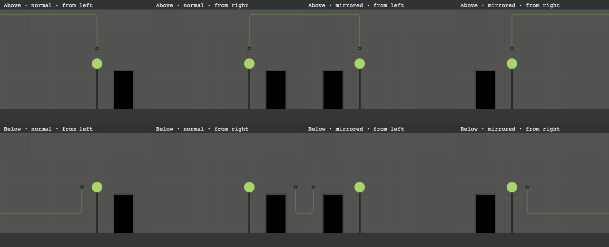

# Jumping level files

All authored levels are JSON assets. The app fetches them at runtime; neither maps
nor the level list are imported into its JavaScript bundle. The builder creates
empty documents, and the engine receives the selected level as data.

For route design, teaching, wall guidance, puzzles, and playtesting, see
[Making a fun jumping level](jumping-level-design.md).
The [campaign canon](jumping-campaign.md) defines the approved required-level
sequence rules and optional B-average certification. The
[outdoor finale brief](jumping-outdoors.md) specifies the escape environment.
D-or-better campaign progression and locked picker slots are implemented.
Version-2 landscapes support daylight above authored cave or facility back walls,
and an untimed outdoor overlook finish. The untimed opening, charging-bay entrance, and optional wall
wiring described below are supported authoring features.

Version 1 remains supported unchanged. Version 2 adds authored lighting, described
below and in the [flat-lighting specification](jumping-lighting.md). The studio
upgrades a level on its first Night mode or spotlight edit; it never silently
removes lighting when saving.

## Placement at level boundaries

Objects may touch the playable rectangle. Plates, props, mechanisms and coin
switches have no extra horizontal inset. Keep the actual footprint inside the
room: a 30-unit ball may start at x = 15, while a plate may start at x = 0.
Creation, dragging, resizing, display conversion and saving use the same bounds.
Shovebots retain clearance for their 26-unit half-width and a minimum 50-unit
patrol span; support and collision checks still apply on slopes. Other wall
objects, pickups and fields already use their own footprint bounds. Attached
ladders may cross their host terrain in the foreground. Ladder landings need
clear standing space; exits need a clear, continuously supported doorway.

## Built-in levels

The asset folder is `public/levels/jumping/` in the repository and `levels/jumping/`
in the deployed app:

- `index.json`: lists the filenames to fetch as `{ "version": 1, "levels": [...] }`.
  It contains no level geometry and lists the built-ins in presentation order.
- `00.json`: First Leap.
- `01.json`: Second Leap.

Add future built-ins directly to this folder. The JSON test lab, old lessons,
playground and counterweight yard live under `tests/fixtures/jumping/` solely for
automated tests. They are not copied into or offered by the deployed game.
The game offers only the built-in catalog. An empty catalog never falls back to a local or account library.

Playable stress challenges live separately in `dev/levels/jumping/`, using the
same JSON schema and manifest. `npm run dev` offers them under **Stress tests ·
Development** as read-only levels to try. They are outside `public/`, excluded
from production builds and unavailable through the production preview. Validate
them with `npm run levels:check:dev`; see [the stress guide](jumping-stress.md)
for recorded routes and numerical benchmarks. Do not move these maps into the
production built-in collection just to make them available for testing.

Local and built-in collections share the same `index.json` manifest format:

```json
{
  "version": 1,
  "order": "listed",
  "levels": ["intro.json", "ropes.json", "tower.json"]
}
```

`order: "listed"` uses this explicit sequence for the picker and Next level.
`order: "filename"`, or an omitted order mode, uses filename order. Connecting a
writable folder without a manifest automatically creates `index.json` in filename
mode, listing its JSON level files without modifying them. Read-only folders use
filename order and show how to enable saving to create the manifest. Existing
manifests are preserved, including on reload. Local files not listed in a custom
manifest appear after its entries, sorted by filename. Missing local files retain
their place as **Missing file** cards with only a Delete action. Invalid manifests
are reported; valid local files remain available in filename
order when the manifest cannot be read. Presentation order is never stored in
individual level JSON files.

Static hosting cannot enumerate directories, so adding, removing, or renaming a
file also requires updating the index. This command preserves the existing mode,
custom sequence and other manifest metadata, removes references to missing files,
and appends newly discovered files in filename order:

```sh
npm run levels:index
```

Editing the contents of an existing file needs no index update. Choose **Refresh
levels** in the game menu to fetch the latest files. Requests and deployed JSON
responses disable caching. Failed files are named in the menu; valid files remain
available. Missing assets do not fall back to a compiled copy.

For an already built app, copy just the level assets into its deployment folder:

```sh
npm run levels:sync
# Or choose another deployment asset folder:
npm run levels:sync -- /path/to/site/levels/jumping
```

This regenerates the index and copies JSON to `dist/web/levels/jumping/` by default.
It removes obsolete JSON files listed by the previous deployment index. Source
and destination asset folders must contain only level JSON and `index.json`;
unexpected files, subdirectories, and symlinks stop publishing. Move unrelated
content out of the asset folder first; leave `Deleted levels` behind when
promoting a local collection. Every source level is validated before
copying, and regular builds (including direct `vite build`) enforce the same
allowlist. It does not compile JavaScript or run gameplay tests. Upload that asset folder
using your hosting deployment process. Regular repository CI still performs the
full build and checks on pushes; the asset-only command is independent of it.
App builds regenerate the index automatically. The local development editor
reads the folder directly and maintains the index as you save, rename and reorder.

## Shared-level safeguards

Level files and manifests have a 1 MB UTF-8 size limit. A collection allows at most
500 level files and 25 MB total, including its manifest. Reads run four at a time;
downloads count actual streamed bytes even when response headers omit their size.
The recycle bin has its own 500-entry / 25 MB budget. Make room in the bin before
moving more levels there when it is full. Save, rename, and restore also check the
destination budget before writing, while preserving external-edit checks.

Thumbnails draw authored geometry only and allocate canvas pixels while visible.
Rope settling and initial world preparation run in a disposable worker. Loading
and compiling its modules has a separate 30-second startup deadline; the
five-second preparation budget starts after the worker reports readiness.
Cancellation terminates the worker in either phase. The **Preparing level**
dialog appears only once preparation has taken a second; until then the current
screen stays, and the game's root carries `aria-busy`. The facility prepares the
places behind nearby doors ahead of time ([the facility](jumping-facility.md)).
Failed preparation keeps the picker and editor responsive. A geometry timeout suggests simplifying ropes
or terrain; a startup timeout asks the player to retry instead. Saved settled
ropes still start in their authored positions.

`npm run security:check` checks the locked dependencies against npm advisories.
CI runs this check along with validation, gameplay tests, lint, build, and browser
regressions. Advisories of moderate severity or above block it. An advisory with
no released fix can pass temporarily only through a dated entry, with a reason, in
`scripts/security-check.mjs`; it blocks again once that date passes. The desktop
package's `security:check` uses the same script and list.

## Development authoring

Level studio is a private development tool. Production builds, including
`vite preview`, offer only the facility and progress: the level library is
development-only, and pause and result screens have no editor or folder actions.
Builder, playtest and library links return to L.A.B.'s start screen at `/lab`;
retired local-file links do not load a collection.

With `npm run dev` open on localhost, open the level library at `/lab/library`
and select **Edit** on a built-in tile, or
**Level studio → Library → New level** to add a level. **Library** contains one
built-in collection. New levels and templates save directly to
`public/levels/jumping/` in this checkout and appear in Git. **Save and Test** saves
new or edited levels before playing. An unchanged saved level starts its test
without writing or renaming any file. **Return to builder** preserves the draft
and undo history.
No browser folder permissions, account level library, or cloud level import is
involved. **Refresh built-in levels** picks up edits made outside the studio.

The repository writer requires the local dev server, same-origin requests and
a per-server token. Network development hosts and production previews cannot
author. Built-in recovery copies live in ignored `.local/jumping-recycle-bin/`,
outside the published assets. Unfinished maps remain editable after restarting
the dev server; build/publish validation requires ready-to-play maps.

Built-in saves normally replace files atomically. Windows sharing locks receive
bounded retries. If a reader permits writing but prevents replacement, the
writer checks the expected contents again and updates the existing file through
a verified handle. It keeps an original-content backup in `.local/` until that
write succeeds or rollback finishes. If rollback also fails, the save error
identifies the retained recovery copy. External edits, links, and denied writes
still fail without being treated as successful saves.

Use `npm run prod` to build and preview the player experience, normally on port
4173 alongside development on port 5173. Restart it to rebuild after changes.

### Using the editor

Click an object to select it, drag it to move it, or drag empty space to select a group.
Selecting a placement tool shows its default-size object under the mouse or
controller cursor while it hovers over the canvas. Every placement tool follows
the cursor in both directions; objects never jump to a distant surface below.
With **Snap** enabled, choose **5 units** (the default) or **20 units** with the
**Grid** control beside Snap. Previews, placement, dragging, resize handles,
terrain nodes, arrow-key nudges and numeric field steps use the selected spacing.
Changing Grid does not move existing objects. Shift + arrow keys still nudge by
one unit. The wall grid and stair template dimensions remain 20 units. Nodes
inserted on slopes stay on the existing edge, snapping along its dominant axis.
Snap also catches nearby surfaces. Hold Alt or disable Snap to bypass this. The preview does not
edit the level; click to place it or drag to set its size. **Place on surface**
(End) moves a selected object to a supporting surface below.
With Pointer and Snap enabled, blue dashed guides mark the horizontal and
vertical center of the level. Dragging a selection snaps its center, left/right
edges, or top/bottom edges to those guides within eight screen pixels. Each axis
snaps independently; a guide becomes solid and shows a diamond when aligned.
Multi-selection and saved groups use their combined bounding rectangle, preserving
the spacing of their members. Center alignment takes precedence over the grid
and nearby surfaces. Alt and Snap off bypass the guides and center snapping.
Space + drag or the middle mouse button pans from anywhere. Placement tools return
to this default interaction after one use unless **Keep placing** is enabled;
press Esc or click the active tool again to stop placing. Zoom centers on the
selected object, or on the cursor for wheel zoom when nothing is selected.
Entrance and exit doors are already part of each time trial. Drag the existing
doors, or select **Entrance door** / **Exit door** in the Inspector’s **Object** tab to edit their position.

The Inspector separates **Level** settings (names, dimensions,
night mode, floor material, and medal times) from **Object** properties. Selecting
or placing an object opens **Object** automatically; switching tabs preserves the
selection. The tabs stay visible while scrolling. With a tab focused, Left/Right
arrows switch tabs and Home/End select the first/last tab.

Object settings are organized into **Behavior**, **Connections**, **Transform**,
and **Appearance**, where relevant. Click a section heading, or focus it and
press Enter, to fold or expand it. **Wall wiring** and **Object help** start
folded; clicking a wire's wall jack opens its wiring controls. Toggle-group names
and deletion are under **Group settings**. Folding sections does not edit the
level. Long connection lists scroll independently and offer a name filter and
connected count. Filtering preserves all wiring. Level settings group dimensions,
lighting and floor material under **World**, with time limits under **Timing**.

Numeric inspector edits preview on the canvas as you type a complete number.
Arrow keys move focus in the direction pressed, following the visible layout.
Press Enter to start editing a focused field, or click it directly with the mouse.
After applying or cancelling, focus stays on the field and arrows navigate again.
Press Enter or leave the field to apply the edit as one undo step; Esc restores
the original value. Fields accept whole numbers, including seconds, and enforce
their supported bounds. Blank or incomplete entries leave the level unchanged;
decimal and scientific-notation entries are rejected.

The **Terrain** tool draws a rectangular starting shape. Select it to resize the
whole shape with the four square handles outside its bounding corners, or drag
the white nodes to change its geometry. Choose **Node** (N), or **Add node** in
the inspector, then click a terrain edge to insert a point at the preview marker.
You can drag the new point immediately, or enable **Keep placing** to add several.
The Node tool also highlights existing nodes under the pointer. Drag one to move
it without first selecting its terrain; the tool stays active for further edits.
Click an existing node, then press Delete / Backspace or use **Delete node** in the
inspector to remove it. At least three nodes must remain, and the outline cannot
cross itself. Arrow keys nudge the selected node; Shift nudges one unit.
Resizing keeps the opposite corner fixed and scales the existing nodes. Resizing
and node edits follow Snap; new points snap along the edge without changing its slope.

Terrain nodes default to **Straight**, with no Bézier handles. Select a node and
use **Bézier handles** in the Object inspector to enable **Corner** (independent
handles), **Smooth** (aligned handles with independent lengths), or **Symmetric**
(aligned handles with equal lengths). Drag its blue handles to curve adjoining
edges; Alt bypasses Snap. Choose **Straight** to remove both handles. Inserting
a node on an existing curve splits the curve and preserves its shape, including
the handles needed by the new node. Only authored nodes appear as white nodes.
Moving a node carries its handles. Resize, rotate, flip, copy/paste, Undo and Redo
preserve curves. Handles must stay inside the room, and curves cannot cross
themselves. Handles are an authoring aid: rendering and collisions share a compact
polygon fitted to the 5-unit grid. Explicitly placed anchors retain their positions;
intermediate samples snap to the grid, with duplicates and collinear points removed.
Node hover hints use a lightweight overlay. While dragging terrain or a handle,
the live outline draws immediately; lighting and the minimap refresh on release.

With terrain selected, the top toolbar enables **Rotate left/right**
(90° per click) and **Flip horizontal/vertical**. Transforms preserve
the bounding-box center, moving inward only when needed to stay inside the room;
rotation is refused if the shape cannot fit without resizing. Names and materials
are preserved. Attached rope anchors follow the same transform. Other objects stay
in place; legacy attached ladders become independent when their terrain rotates.
Each action can be undone or redone. Slopes become ordinary editable polygons when
transformed; no new level-file fields or gameplay rules are involved.

The Object inspector's **Draw order** controls overlapping terrain. **Backward**
and **Forward** move one layer; **Send to back** and **Bring to front** move to
either end. The position counts from back to front. Pointer selection and tied
node/edge picks follow the visible order. Changes support Undo and Redo and are
saved with the level. New and duplicated terrain starts at the front. Collision,
terrain indices, and attached ropes and ladders remain unchanged.

Click again at the same point to cycle through overlapping objects from front
to back, including wall items inside water rectangles. Dragging moves the current
selection; a click changes to the next overlapping object when released.
Reaching a saved group selects all of its members. The next click selects just
the member under the pointer, then further clicks continue through overlaps.

**Shift-click** adds or removes objects from the selection. Repeated Shift-clicks
at the same point cycle through overlapping objects, toggling each one while
preserving the rest of the selection. A member of a saved group toggles the whole
group. Holding Shift after an ordinary click
continues with the next object behind it. Dragging from empty
canvas selects objects intersecting a rectangle; **Shift-drag** adds to the
existing selection. Space-drag and middle-button drag pan. Drag any selected
object or use arrow keys to move the group by one shared offset. Its spacing is
preserved when a room edge stops movement. Selected children of terrain or
mounted plates move once with their selected hosts.

**Cut / Copy / Paste** (Ctrl/⌘ + X / C / V) transfers selected objects through the
system clipboard, including between levels and browser tabs. A local copy also
survives switching levels and reloading the same tab when browser clipboard
access is blocked. Text fields retain their normal text clipboard shortcuts.
Objects copied from another level paste near the center of the current view;
repeated pastes are offset and the whole group stays inside the room.
**Duplicate** (Ctrl/⌘ + D) also accepts groups. Pasted
groups preserve their layout and terrain order, remap copied rope/ladder anchors
and plate mounts, and receive independent device IDs with their internal wiring
intact. Children copied without their hosts become independent. External switch
connections are retained only within the source level. Entrance and exit remain
unique and are excluded from copies and deletion. Rotate and flip are enabled
when all selected objects are terrain, acting around the entire group's center.
Every group move, paste, deletion, or transform is one undoable edit.

**Group** (Ctrl/⌘ + G) keeps two or more selected objects together. Groups are
saved with the level. Clicking any member selects the whole group; once the group
is selected, clicking a member again selects just that object for individual
editing. Dragging a member while the group is selected moves the whole group.
The object picker and Node tool also allow individual member editing. Shift-click
adds or removes a whole group, and marquee selection includes a whole group when
it touches a member. **Ungroup** (Ctrl/⌘ + Shift + G) releases selected groups.
Grouping existing groups merges their members into one flat group. Copy, paste
and Duplicate preserve copied group memberships using independent group IDs;
one copied member stays independent. Deleting a member preserves groups with at
least two remaining members. Group and Ungroup each use one undo step.

Both file versions accept optional `editorGroups`, an array of up to 512
`{ "id": "group-id", "members": [{ "kind": "platform", "index": 0 }, ...] }`
records. Members use the editor's object kinds and zero-based collection indices;
entrance and goal use index 0. Each group needs 2–1,000 existing members, a unique
nonempty ID of at most 100 characters, and no object may belong to two groups.
The editor updates indices after deletion. Groups affect editor selection only;
members retain their independent gameplay behavior and wiring.

**Terrain → Steps narrow / Steps wide** stamps five one-grid-square
rises with treads one or two squares wide. Both have a stepped underside formed
by five one-square-thick steps overlapping their neighbors by one square.
Narrow steps are two squares wide; wide steps are three squares wide, including
the top landing. The overall size is 6 × 5 or 11 × 5 grid squares
(120 × 100 or 220 × 100 units). Click to place the full-sized template; it stays
inside the room even near an edge. **Keep placing** repeats it. Each template
becomes one ordinary terrain piece with editable nodes,
dimensions, material, duplication, transforms, and undo/redo.

**Movement → Tied rope** places a rope tied at both ends: drag from one anchor to
the other, and an end near a terrain edge attaches to it. The rope sags by its
extra **Length**. Selected, it shows a handle on each anchor; dragging either moves
that anchor alone. The inspector attaches or detaches **Anchor 1** and **Anchor 2**
separately, **Untie anchor 2** turns it back into a hanging rope, and **Tie the
free end** ties a hanging rope where its end rests. **Release** chooses whether
switches can let go of anchor 1 or anchor 2; wire switches to the rope like any
other switched object.

The development level library, `/lab/library`, loads the built-in JSON
collection and lists it in the order the facility plays it (`libraryOrder.ts`).
Facility areas are not tiles: each heads the row of courses it leads to. Areas
without level doors come first, nearest the start first. The wings follow in the
order the concourse opens them, each with its courses in the order their doors
open. A course an exit leads into follows the course before it. The dispatch
door's final course and the route on from it come after every wing. Levels the
campaign never reaches come last, under **Not in the campaign**. In local dev,
each area heading has **Edit**. A collection without the campaign's start, such
as a test fixture catalog, is one plain list. **Next level** after a library run
follows the library's order. Click a tile, press Enter,
or press controller A to play. Timed tiles show personal bests and letter grades;
untimed tiles show completion. Finishing updates those records. In local dev,
unready maps show repair messages and remain editable. Each tile has **Play**;
local dev adds **Edit** and deletion. Controller or keyboard Y edits the selected
level only in local dev.

The library follows the facility's locks. A wing course is open when its door
is: its wing is open, and it is the wing's first course or the course before it
is passed (D or better; untimed levels need completion). The final course and escape levels open once every wing course is
passed. Levels outside the campaign are always open, and a collection without
the campaign's opening area, such as a test fixture catalog, leaves every level
open. Locked slots show only their number and a lock, with no thumbnail, name
or play/edit actions. The studio library and playtests remain unrestricted by
campaign progress. See [the facility](jumping-facility.md) and
[the campaign](jumping-campaign.md) for the progression rules.

Level studio supports standard controllers. **Y / △** switches between editor
controls and the canvas cursor. Returning to the controls restores the last
focused control and its inspector tab, including after entering with B, Tab, or
the mouse. The left stick, D-pad, and keyboard arrows move
focus according to the controls' positions; edges do not wrap. **A / ×** activates
buttons, checkboxes, and lists, or starts editing a field. While editing numbers,
Up/Right increases the value and Down/Left decreases it; A finishes and B cancels
the current entry, returning to navigation. A opens an on-screen keyboard for
names and wall text. **B / ○** cancels a drag, field entry, list, or dialog;
otherwise it also switches between the canvas and the last focused control,
keeping the selected object. The right stick scrolls the focused panel. Help's
**Controller** topic lists every binding.

On the canvas, the left stick moves the cursor. Hold A while moving to draw,
drag, resize, or edit terrain nodes, then release to apply one undoable edit.
The D-pad nudges the selected object or node. The right stick pans; the triggers
zoom out/in. Clicking the left stick gives fine movement, one-unit nudges, and
drags without snapping. **X / □** duplicates; **LB / L1** and **RB / R1** undo and
redo. **View / Share** opens Library; **Menu / Options** saves and playtests.
During a canvas drag, Menu first cancels the preview; press again to test.
Held inputs must be released after changing screens, opening a dialog, or
reconnecting. Leaving the window or disconnecting cancels an unfinished drag.

In the studio, **Library** provides **New level**, built-in files, templates,
ordering and a recycle bin. Opening another level prompts about unsaved changes.
**Use as template** creates an independent draft with new IDs and remapped
connections. **Save level** writes to the built-in collection; **Save and Test**
waits for a successful write when the draft has changes, and directly tests an
unchanged saved level without a write. Renames keep level identity and
update the manifest. External-edit checks protect changes made outside the
studio; a failed write leaves the current draft editable.

The studio library opens sorted by **Campaign order** whenever the campaign
covers the collection, the way the development level library lists it
(`libraryOrder.ts`): each facility area before the courses behind its doors, the
wings in the order the concourse opens them, and levels the campaign never
reaches last. **Level name** sorts alphabetically. Both only change the view.
**Saved order** shows the manifest's own order, which places levels outside the
campaign: drag entries or use Alt + arrow keys to reorder them, and the manifest
saves the order automatically. **Save as campaign order** and **Save as name
order** rewrite it in one step. **Delete** moves a built-in to the private recycle bin;
**Recover** restores it without overwriting another file. Permanent deletion and
emptying the bin require confirmation. Recovery files never enter published
assets. Add external JSON by placing it in `public/levels/jumping/` and refreshing
the dev library; use `npm run levels:check` before release.

Library tiles, builder templates and the overview all use the
game's world renderer for their static previews. They include props, shovebots,
pressure plates, both gate orientations, elevators, moving platforms, ropes, ladders, timers, text,
pickups and goal exits in their starting state.

`/lab` opens the start screen, and `/lab/facility` is the facility in play. A
direct link, `/lab/levels/built-in/<filename>`, plays a level when it is open; a
course with a door in the facility returns the robot to that door, at
`/lab/facility`, when finished or left. A locked course, a facility area or a
missing file opens the start screen instead, with the reason. The development
library is `/lab/library`, reached only by its address or the **Level library**
button on the facility's opening screen. Only a run started there returns to
it; the studio's **Back to game**, playtests and the development review pages go
to the facility. Development editing uses
`/lab/builder/built-in/<filename>`, and saved playtests append `/playtest`.
Filenames are URL encoded. Back, Forward and reload preserve the intended route.
Production redirects authoring URLs and the library to `/lab`. LAB entry points
use `/lab`; the former untitled-game and local-library routes are retired.

Published hosting rewrites `/lab/*` to the app shell, including playable URLs
ending in `.json`. Raw JSON assets remain under `/levels/jumping/`. A saved file
keeps its ID; a template gets a new ID. Built-in IDs identify completion and best
records and must stay unique across the collection.

## Validation and reference level

`tests/fixtures/jumping/00-json-test-lab.json` exercises every supported field: rectangular,
polygon and profile terrain; start, exit and checkpoint radius; attached and free
ladders; attached and free ropes with saved points, bends and material distances;
boxes, balls, a pusher, pressure plates, an elevator, a gate, stopwatch pickups, wall timers,
multiline wall text and medal times.
Browser tests supply it explicitly through their level fixture helper.

```sh
npm run levels:check
node --test tests/jumping-level-assets.test.mjs
```

The first command validates the indexed files without building the app. The tests
check the reference level's round trip and gameplay, invalid field values, runtime
refresh, filename ordering, file failures, local saves and external-edit conflicts.
Movement regression tests load JSON fixtures from `tests/fixtures/jumping/`.
Browser tests inject those files through the asset loader; none are shipped as
hidden built-ins.

## File format

The version 1 file contains `id`, `name`, `width`, `height`,
`entrance`, `platforms`, `checkpoints`, and `climbables` (ladders and ropes). A timed
trial also includes `floor`, `goal`, `times`, `props`, `robots`, `mechanisms`, and
`triggers`. Empty arrays are explicit. Old playground files without trial fields
remain readable. Legacy `description` fields are ignored; use wall text for
in-level guidance.

Every object, including start, goal, and spotlights, accepts an optional `name` string of up to
80 characters. The Inspector's **Name** field sets it; clearing it restores the
default label. Names appear in the inspector heading, object picker, switch
connections, rope anchors, and object-specific validation errors. Labels retain
the object type and number to distinguish unnamed objects and duplicate names.
They survive edits, duplication, templates, and saves. Surrounding whitespace is
trimmed, and empty names are omitted. Mechanism connections still use their stable
IDs, so renaming a mechanism or spotlight does not change its connections.

Optional `timers: [{ "x": 80, "y": 1220 }, ...]` places up to 40 wall displays.
Each point is the top-left of a 120 × 40 (six-by-two-tile) digital display
in file coordinates. The entire display must fit inside the room.
**Back wall → Wall timer** places one in the builder; select it to move,
duplicate, or delete it. Inspector Y measures its top
above the floor, and increasing level height preserves that height. Terrain edits
do not move these wall objects.

Every display counts the run's time up from `00:00` as glowing seven-segment
minutes and seconds, with no hours or fractions. The face saturates at `59:59`;
the underlying run time, grades, and best times retain their full precision and
range. Earlier, larger clocks keep their saved top-left positions. Digits are
green normally and on completion; the left LED bay shows the current A/B/C/D/F
grade. Freeze/fast effects keep their amber/red digit colors. The face pauses
with the game and latches on exit entry.

When fewer than 10 seconds remain before the D deadline, the run warns of the
coming power-down once a second of play: every clock lights red for the first
half of each second, the level's border glows red, swelling on each beat,
and a quick double pip sounds, a little higher for the last three seconds. The
warning keeps going, through a stopwatch's freeze, until the level powers down.
Reaching the exit first ends it, as does a time bonus that takes the run back
above 10 seconds before the deadline.

At F the clock stops at the D deadline, showing the limit that was passed, and
dims, and the level powers down for the rest of the run. Restart restores the
clock, power and pickups. Time bonuses can improve the current grade and time
before F, but cannot revive a failed run.

Powering down at F works like an EMP outage that never ends. Gates, elevators
and moving platforms stop where they are and stay solid. Plates and float
switches stop responding, and force fields and gravity plates switch off. Shovebots
stop and Rbot slumps to its knees, wiring and coin meters go dark, and carried gadgets read **Power off**.
The room lights cut out with a breaker clunk and a winding-down hum: after a
brief flicker, a daylit room renders as night with every lamp off, so the open
exit's glow stands out. Every coin, clock collectible and EMP still in the
level flickers out and can no longer be collected. Water,
ropes, ladders, and loose boxes and balls keep working. The exit opens, a
switched exit included, so the player can still leave with an F. They can also
keep exploring, or restart from the pause menu.
Displays are drawn behind terrain and actors and have no collision. Their size
and position follow the world camera. There is no visible HUD clock; levels
without `timers` simply have no wall display. Older files may omit the array.

Optional `pickups: [{ "kind": "stopwatch", "x": 260, "y": 1360 }, ...]` places
up to 80 pickups (all kinds combined) in a timed trial. Coordinates mark the center of the watch
face; its bounds extend 24 units left/right, 32 above, and 20 below and must fit
inside the room. Choose **Collectibles → Stopwatch** in the builder to place one,
then move, duplicate, delete, or undo it like other objects. Inspector X/Y use
the top-left of those bounds; increasing level height preserves its height
above the floor. Older level files may omit `pickups`.

Only player contact collects a stopwatch. It stops the level timer for 10 seconds
of gameplay, immediately pulses, then shrinks away over 0.34 seconds. The player,
enemies, and mechanisms keep moving normally. Extra watches add another 10 seconds
to the remaining pause. Time is never subtracted; the clock resumes from the same
value when the effect expires. Wall timers turn amber and show a small pause mark
while stopped. Medals and saved best times use the full-precision run time.

Pausing the game also pauses the remaining effect and pickup animation. A watch
collected at the start keeps its full duration until the first movement starts
the run. Restarting restores every pickup, clears the effect, and resets the time
to zero. Entering the exit locks the result and ends collection. Crates, balls, and pushers
cannot collect pickups, and pickups do not obstruct movement.

**Collectibles → Time bonus** places a counterclockwise arrow with a number inside.
Set **Seconds off** to an integer from 1 to 9 (default 5). The JSON shape is
`{ "kind": "time-bonus", "seconds": 5, "x": 260, "y": 1360 }`.
Player contact immediately subtracts that many elapsed seconds, stopping at zero;
any unused seconds are discarded. It does not start or extend a stopwatch pause.
The item has the same placement bounds, pulse-and-shrink animation, and collection
sound as a stopwatch. The displayed number follows the configured value in the
editor, previews, and gameplay. Restarting restores it.

**Collectibles → Time penalty** is the dark-red opposite of a time bonus: its
arrow points and rotates clockwise, and contact adds the numbered seconds to
the clock. Set **Seconds added** from 1 to 9 (default 5). Its JSON shape is
`{ "kind": "time-penalty", "seconds": 5, "x": 420, "y": 1360 }`.
The number lifts directly from the icon as a fading `+5` while the arrow pulses
and shrinks. Penalties apply immediately even during a stopwatch freeze. Bonuses
and penalties touched in the same step are combined before clamping to zero.

**Collectibles → Fast stopwatch** uses the same dark-red color, with a hand
sweeping clockwise once every 1.2 seconds, versus the normal watch's slower
counterclockwise sweep every 8 seconds.
Its JSON shape is `{ "kind": "fast-stopwatch", "x": 500, "y": 1360 }`.
Contact makes the level clock run at **2× speed for 5 seconds** of gameplay;
the player and world keep their normal speed. Wall timers turn red and show a
fast-forward mark during the effect. Additional fast watches extend its duration
by 5 seconds each, without increasing the multiplier. A normal stopwatch still
freezes the clock; both durations count down during gameplay, including their
overlap. Pausing the game pauses both effects. A fast watch collected before the
run starts keeps its full duration until movement starts the run.

Both harmful pickups share the existing collection bounds and pulse-and-shrink
animation, with a lower collection chime. Only the player collects them. Restart
restores them and clears their effects; entering the exit locks the score and
ends collection. Medals and best times include all penalties.

**Collectibles → EMP** places a solid gold lightning bolt. It spins about its
vertical axis with the same thick edge and pace as a coin. Collection sends out
a gold ring as the bolt pulses and shrinks away,
with a soft power-down sound. Its JSON shape is
`{ "kind": "emp", "x": 600, "y": 1360 }`. Coordinates mark the center;
its placement bounds extend 24 units in each direction.

Player contact cuts power to **all gates, elevators, moving platforms, switches, and shovebots for
5 seconds**. Gates, elevators, moving platforms, and bots stop in place and resume from the same
position and phase afterward. They remain solid; a disabled bot cannot shove. Rbot instead slumps
to its knees where it is, letting go of any rope, ladder or ledge it holds and falling if it must. It
can be pushed like a heavy crate, and it gets up where it was left when power returns.
Always-on exits and exits held open by latched switches keep working. The clock, player, ropes, and loose
objects continue normally. Clock collectibles do not change the outage duration.

Coins still collect and fill every coin meter during the outage. A full meter
stays gold until power returns, then switches on and turns green. An already
activated coin switch stays latched through an EMP. Switch and Toggle plates also
retain their state. Plates do not register new presses during the outage; Pressure
plates turn off and respond to their current load when power returns. A switched
exit follows its inputs, so a Pressure-powered exit closes during the outage.
Extra EMPs add 5 seconds each. Pausing pauses the outage, a pickup collected before
the run starts keeps its full duration, and restarting clears it.

**Collectibles → Coin** places a plain gold disc with a thick edge that spins slowly, pulses and
disappears on player contact, with a short chime. Coins use
`{ "kind": "coin", "x": 260, "y": 1360 }` in the same `pickups` array.
Their center-based bounds extend 20 units in each direction. They increase the
level-wide collected total once each and do not change the timer. Their spin and
collection animation pause with the game; restart restores all coins and clears
the total. Collection remains available until the player enters the exit or the
run reaches F.

**Mechanisms → Coin switch** mounts a numeric display on the back wall, behind
terrain and actors with no collision. Set **Coins required** (1–80, default 3)
and check gates or elevators in **Activates**. Each switch uses the same collected
total, with its own threshold. Coins are not spent. New switches have the same
fixed 120 × 40 digital face as wall clocks, showing
`00/00`: collected total / required goal, both with leading zeros. The numerator
continues past the goal. Digits glow gold until activation, then green; a full
switch awaiting power during EMP stays gold.

Choose **Display → Numeric** to convert an existing bar, preserving its name,
threshold, connections, and center where room bounds allow it. Conversion can be
undone. Choose **Progress bar** for a segmented LED meter, then
**Orientation → Horizontal** to fill left to right or **Vertical** to fill bottom
to top. Every coin switch keeps its connected
mechanisms active until restart. An ordinary plate or another full coin switch
can also power the same mechanism. The editor flags thresholds above the number
of coins placed in the level.

Coin switches share the 40-switch limit with pressure plates. Their file shape is
`{ "mode": "coins", "x": 400, "y": 1200, "w": 200, "threshold": 3, "targets": ["gate-id"] }`.
This older file shape remains supported unchanged and retains its bar style.
Both bar orientations share the numeric face's dark frame and recessed glass.
Separate LED cells glow gold as coins are collected, then green on activation;
empty cells stay dim, and dark gaps separate the cells.
Numeric switches add `"display": "digital"`, use `"w": 120`, and omit
`orientation` and `h`. Their height is fixed at 40. Opening an old file does not
convert bars or rewrite the file.

For progress bars, coordinates mark the top-left of a one-tile-thick (20-unit) display;
its length is editable from 120 to 240 units. Horizontal switches omit `orientation` and use `w` for
their length. Vertical switches use `"orientation": "vertical", "w": 20, "h": 200`;
their height is editable in the inspector or with the top and bottom handles.
Changing orientation preserves the center where room bounds allow it.
They stay on the wall when terrain moves, and support names,
duplication, undo/redo, saving, and reopening like other objects.

Optional `texts` places up to 80 text areas on the back wall, in both trials and
playgrounds. Each entry has `x`, `y` (top-left in JSON coordinates), `w`, `h`,
`text`, `fontSize`, and `align` (`left`, `center`, or `right`). For example:

```json
"texts": [{ "x": 80, "y": 1100, "w": 320, "h": 100,
  "text": "Run up.\nPress to jump.", "fontSize": 24, "align": "left" }]
```

Official text uses muted stencil lettering painted directly on the wall, with no
panel or outline. Explicit newlines are preserved; words wrap at the area's
width, and excess lines are clipped to its
height. Font sizes range from 12 to 96 world units, text is limited to 1,000
characters, and areas are 40–2,000 units wide and 24–1,200 units high, bounded by
the level. Choose **Back wall → Wall text** in the builder, then edit content,
font size, alignment, position, and dimensions in the inspector. **Style** selects
painted **Official** stencils or **Graffiti** marker lettering, muted red in daytime
and warm yellow in night mode for readability. Graffiti drips from the bottoms of
its strokes and wears with the room's **Stains** setting (see
[Graffiti](jumping-wall-wear.md#graffiti)). The wall fonts are bundled with
the game and work offline. **Rotation (°)** turns
the area around its center, from −180 to 180 degrees; positive values turn
clockwise. The selection frame and resize handles rotate with it. In JSON,
`style: "graffiti"` and `rotation: -12` are optional; omitted fields retain the
original upright Official style. Rotated areas stay within the room. Text can be
duplicated, deleted, undone, and copied through templates. It moves with the
camera, sits behind terrain and actors, and never affects physics. Growing the
level adds space above it. Older files may omit `texts`.

**Back wall → Message screen** mounts a small dark terminal with softly glowing
green monospace lettering. It is a text area with `style: "terminal"`, using the
same content, font size, alignment, rotation, resize, copy, and undo controls.
Explicit newlines and wrapping work inside a small inset; excess text is clipped.
The message is static and immediately visible. Its lettering retains at least
65% exposure in Night mode, like clock digits; the frame follows room lighting.
It illuminates no surrounding surfaces, casts no shadow, and has no collision
or switch behavior. Screens count toward the same 80-area text limit and render
behind terrain and actors in play, previews, and thumbnails.

```json
"texts": [{ "x": 340, "y": 530, "w": 300, "h": 90,
  "text": "OPERATOR CONNECTION\nNO RESPONSE", "fontSize": 17, "align": "left",
  "style": "terminal" }]
```

**Back wall → L.A.B. wall stamp** places the facility mark with its small,
full-width `experiments` subtitle and an ink border. It is an ordinary wall text
area with `style: "lab-stamp"`; its mark is fixed, while position, width, height,
rotation, duplication, and undo/redo work like other wall text. The logo fits the
area without stretching. It uses muted red ink by day and warm yellow at night,
renders behind terrain and actors in gameplay, editor previews and thumbnails,
and has no collision. Its ink is worn by the level's **Stains** setting: crisp at
None, chipped and scuffed more heavily at Heavy than at Light, differently for each
stamp. Stamps count toward the same 80-area wall-text limit.

```json
"texts": [{ "x": 100, "y": 200, "w": 240, "h": 110,
  "text": "L.A.B.\nexperiments", "fontSize": 28, "align": "center",
  "style": "lab-stamp", "rotation": -5 }]
```

The builder uses `(0, 0)` at the bottom-left, with positive X to the right and
positive Y upward. Inspector Y measures the object's top, a rope's anchor, or a
marker's feet above the floor. Grid snapping uses this same origin. Changing level
height adds or removes space at the top, preserving the entire layout's height
above the floor; shrinking stops before cropping an object. Undo restores the size
and layout together.

Version 1 **file and runtime coordinates** still use positive Y downward for
compatibility with existing levels. Convert an editor Y with `levelHeight - Y`.
The playable room is `[0, width] × [0, height]`; legacy trial files use `floor` as their interior
height. New editor files keep `height` and `floor` equal. Terrain outside all four
edges is structural and generated by `levelTerrain`, so it need not be authored.
The renderer fills the full outside viewport, with no visible end to the terrain.
During play, the camera leaves a 32-pixel margin below the room's floor,
independent of zoom. The player moves up toward the screen center
while climbing, then the camera follows them in the center as before.

Balls and boxes collide with each other, transfer momentum, and can rest on one
another. Balls use round contact against other balls and box corners. Larger
props carry more mass, and boxes are heavier than equally sized balls.
Select **Weight: Normal / Heavy** on each ball or box. Normal is the
default for existing files. Heavy has three times the normal mass, sinks in
water, and yields less to shoves, collisions and gravity-plate lift.
Ordinary falling, positive gravity and zero gravity keep the same
acceleration for every weight. Heavy crates are dark riveted metal. Heavy balls
keep the offset dark dot on a darker metal-colored body, with two smaller light
grey dots following a short arc to suggest the sphere's shape.
Save the optional preset as `"weight": "normal"` or `"heavy"` on a prop;
omitting it preserves normal behavior. The retired `"light"` preset loads as normal.

**Gadgets → Carried EMP / Repulsor rifle / Tractor gun** places a right-forearm sleeve. Save it
as a `props` entry with `kind: "box"` and `gadget: "emp"`, `"repulsor"` or `"tractor"`,
and the usual `x`, `y`, `size`, optional name and weight. The default scale is 40;
its actual rectangular hull is `size * .4` wide and `size * .2` high. As with
other props, X is the center and Y is the unrotated bottom. The editor shows that
footprint. Loose sleeves rotate, fall, float, and contact plates as physical
props. The player passes through loose sleeves without tripping or pushing them;
walking over one does not collect it. Normal weight floats; Heavy sinks.
E / controller X picks up or drops;
F / RT fires it. The EMP sends a traveling bolt that disables the hit device for
five seconds, with a one-second cooldown. It remains equipped after firing.
A hit anywhere on an active blue or red force-field beam, or either emitter,
disables only that field; its normal power and clearance rules apply afterward.
The repulsor pushes the first loose prop or bot along its beam; the tractor pulls
it back toward the player with the same impulse and nothing slowing its arrival,
so a pulled crate, ball or bot hits the player. Neither moves terrain, gates,
lifts or the player's own footing.
Movement directions also point any tool in eight directions;
neutral input returns to horizontal hip fire. The arm shows direction without a
reticle. Active red fields drop the sleeve on the approach side while the player
continues through.
Equipped sleeves permit normal traversal, including climbing, grabs, pushing,
and wall jumps. Aim/use pause only while the right arm supports the player.
See [the gadget contract](jumping-carried-gadgets.md) for hand support,
field interactions, cooldown, and prototype tuning. Existing `pickups` with
`kind: "emp"` remain automatic collectibles.

Crate branding is optional per box. **Objects → L.A.B. crate** places a box with
`"branded": true`; the ordinary **Box** tool creates a plain box. The box
inspector's **L.A.B. branding** checkbox changes either style. Omitted or false
`branded` values keep crates plain, including existing files. Both normal wooden
and heavy metal crates support the stencil. Branding follows the crate's rotation,
survives duplication and saves, and changes artwork only: size, weight, buoyancy,
and collisions are identical. Balls do not accept a branding field.

Boxes rotate, settle on their faces, and tip over edges. Moderate slopes can hold
a resting box; steeper slopes let it slide or tumble. Pushing applies a limited
force, with the player's hands following the tilted face and steps following
actual progress. Balls contact the complete terrain outline, including corners
and valleys. Placed props are lifted clear of terrain before play starts.
Falling boxes and balls make a brief impact sound when they land on the floor,
terrain, elevators or supported props. Harder landings sound stronger, larger
objects sound lower, and resting contact stays quiet.
Shovebots keep both wheels on connected slopes, tilt with the terrain, and stop
at cliffs and walls. A gate can slide past a ball touching its side while still
stopping before it would crush a prop beneath it.

The goal is an exit door with a pole indicator; it has no built-in pressure plate.
Like every door, the open exit is entered with **Up** while the robot stands in
its doorway; walking past it does nothing. Holding Up on the way in enters on
arrival, so the press costs no time against the deadlines.
Select it in the builder to choose **Power: Always on** (the default) or **Switched**.
Always-on exits start fully open. Switched exits use the same **Switched by** and
**Activates** connections as gates, platforms, and spotlights. Its switch logic
and Reversed setting open and close the exit (OR by default). For a permanently unlocked
exit, connect a separate plate in Switch mode or a coin switch.

The saved `goal: { x, y }` point remains the legacy assembly origin, at floor height,
so existing doors and indicators do not move. The indicator stands 44 units to
its right, 96 units above the floor. The door is 40 units wide and 80 high,
centered 100 units to the origin's right. **Flip horizontally** mirrors both around
the origin, saved as `goal.flipX: true`. Leave flat support from the indicator to
the doorway and clear space above the door; the old plate area needs no support.
Drag the exit and indicator together in the builder. Closed doors blend into the
back wall; the builder and thumbnail show a dashed doorway guide.

The optional `goal.power` is `"always"` or `"switched"`; omission means Always on,
including in existing files. A switched goal also requires a unique `goal.id` for
connections, for example `goal: { "x": 800, "y": 920, "id": "exit", "power": "switched" }`
and a plate with `targets: ["exit"]`. The builder assigns the ID automatically.
IDs must be unique across the exit, mechanisms, and spotlights.

In the facility, a plain exit door can lead on when its run passes:
`goal.leadsTo: { "level": "<level id>", "arrival"?: "<door id>" }`. A course
is entered at its start; a facility area at its entrance, or out of the level
door or bulkhead named by `arrival`. Without `leadsTo`, and always after an F or
when the robot leaves from the pause menu, it goes back where it came from.
Overlook, walk-off and bus exits end the game and cannot lead on. In the studio,
**Object → Leads to** on the exit chooses the level, and **Arrives at** the door
when that level is a facility area. See [the facility](jumping-facility.md#where-doors-and-exits-lead).

Opening the exit does not stop the clock or lock the medal. The player must walk
into its fully open doorway. Passing above it or rolling an object through it
does not finish the level. Entry locks scoring and takes a short final step into
the door; only after that animation does the result appear and save the personal
best. Once entry begins, a released switch cannot interrupt it. Pausing freezes
door and entry animations. Restart restores all authored initial states. The
camera follows the player when a distant switch opens the exit.

Existing version 1 files with `flag: { x, y }` remain readable with their original
door placement and default to Always on. Saved files use `goal`; if both fields
are present, `goal` takes precedence. No built-in level files need rewriting.

The entrance uses `entrance: { x, y }`, where X is the door center and Y is its
flat sill. It is 40 units wide and 80 high, matching the exit doorway without
an indicator. Its full width needs continuous flat terrain and clear headroom.
The editor selects and draws the doorway. Legacy `spawn` positions load as
entrances at the same coordinates; new saves use `entrance`.

On play and restart, the silhouette fades into view and takes a short step out
of the open entrance, then the door closes into the wall. The entrance lasts
1.35 seconds. The clock and physical world remain frozen during it and start
automatically as soon as it disappears. Pause freezes the entrance too.

For an awakening, use `entrance: { x, y, kind: "charging-bay" }`. It keeps the
same supported 40-by-80 footprint and placement rules. An installed capsule with a rounded shell, recessed cradle, and split glass cover
remains on the back wall. Over 3.6 seconds, its quiet green power strips return,
the existing robot rig raises its head and shoulders, and the cover retracts.
The camera begins closer to the occupied pod and gently reveals the room before
control and the world activate automatically.
Pause freezes that sequence; restart repeats it. No doorway is drawn or closed.
Choose **Object → Entrance → Charging bay** while the entrance is selected;
**Door** restores the ordinary entrance. Both styles preview, save, and reopen. The pod has a 102-by-126 artwork outline
for selection; its collision and start validation keep the clear 40-by-80 footprint.

### Facility areas

`"kind": "hub"` makes a level a facility area, part of the building between
courses: the opening, the concourse or a wing (see [the facility](jumping-facility.md)).
It is untimed (`"timing": "untimed"`), has no `goal` or `times`, and the robot
leaves only through its doors, by pressing Up in an open doorway. It may hold
everything a course does except timing equipment: coins, coin switches, wall
clocks and time pickups stay in courses. Tools and EMP charges are allowed.

- `courseDoors: [{ id, x, y, course, returnsTo?, dispatch? }]`: level doors.
  `course` is the ID of the level behind the door. Coming back from that level,
  the robot steps out of this door, or of `returnsTo`, the ID of another level
  door or bulkhead in this area. `dispatch: true` marks the dispatch door, the
  facility's Exit, to the final course: drawn as a heavier bulkhead lettered EXIT,
  released once the evaluation is complete, and not itself part of the
  evaluation. The facility has one.
- `bulkheads: [{ id, x, y, to, arrivesAt? }]`: doors to other facility areas.
  `to` is the ID of the facility area beyond it. Arriving through a bulkhead
  steps out of `arrivesAt`, a level door or bulkhead in that area, or else the
  bulkhead there that leads back.
- Level doors and bulkheads go by where they lead, so neither has a `name`;
  one saved on them is dropped when the level loads.
- `power: "switched"` on a level door or bulkhead opens it only while its
  wiring is on, like a switched exit, with optional `switchLogic` and
  `switchReversed`; its `id` is its switch ID. Without it, a level door or
  bulkhead is always open. A level door whose course is passed stays open,
  whatever its wiring says.
- `targets` on a bulkhead lists what it switches once the area beyond it is
  complete: every level door in that area passed.
- `targets` on a level door lists what it switches once the level behind it is
  passed: at D or better, or completed if untimed.
- `gradeGates: [{ id, name?, x, y, doors, grade, switchReversed?, targets? }]`:
  studio-only grade averages. `doors` lists level door IDs in this area;
  their best grades score A 4, B 3, C 2, D 1 and 0 for an F or no finish, and
  the node is on while the average reaches `grade` (`a` to `d`).

For example, the second door opens once the first course is passed, and a
bulkhead once both average a B:

```json
"courseDoors": [
  { "id": "door-one", "x": 500, "y": 920, "course": "<first course id>", "targets": ["door-two"] },
  { "id": "door-two", "x": 900, "y": 920, "course": "<second course id>", "power": "switched" }
],
"bulkheads": [{ "id": "way-on", "x": 1400, "y": 920, "to": "<area id>", "power": "switched" }],
"gradeGates": [{ "id": "b-average", "x": 900, "y": 300, "doors": ["door-one", "door-two"], "grade": "b", "targets": ["way-on"] }]
```
- `evaluationBoards: [{ id, name?, x, y, w, h }]`: wall displays of the
  evaluation, filled in during play.
- `"optional": true` makes the area an optional wing: its courses are extra
  challenges outside the evaluation. They never count toward its total, its
  completion, the dispatch door or the release certificate, and the evaluation
  board and start screen list the wing, marked optional, only once it is open.
  Studio: **Level → Optional wing** on a facility area. Its bulkhead is an
  ordinary one; leave its `targets` empty so nothing required waits on it.

Doors and bulkheads share the entrance's flat 40-by-80 doorway, with `x` at the
middle of the sill. Each has its destination's name lettered on the wall above
it, and a level door hangs a placard of its course's data to the right. In the
studio, as in the facility, a level door or bulkhead goes by where it leads;
a saved `name` on one is ignored. An empty `course` or
`to` saves, but validation asks for a destination before the level is played.
In the studio, **Level → Type → Facility area** converts a course (its doorway
exit becomes a bulkhead, its destination still to choose) and **Course**
converts back (the first bulkhead becomes the exit). The Facility tools place
level doors, bulkheads and evaluation boards, and **Object → Leads to** chooses
where each door goes: a level door lists every course in the collection, and a
bulkhead every other facility area. **Returns through** on a level door and
**Arrives at** on a bulkhead choose the door the robot steps out of, and
**Exit door** marks the dispatch door, the facility's Exit, to the final course.

`timing: "untimed"` makes a finishable level untimed. Enable **Level → Untimed
level** in the studio. The world and animation time still advance, but the
score stays zero, time pickups cannot change it, and no medal or personal best
is awarded. The tile, screen-reader status, and result omit timing and grades.
The shared trial shape retains increasing positive `times` values for a later
return to timed mode; those values are ignored while untimed. Completion saves
separately from best times, using stable IDs and the same local/built-in record
namespaces, and participates in account backups and cloud sync.

In the facility, every untimed level, facility areas included, keeps its state
between visits: props, mechanisms, switches, float switches, water levels and
released rope anchors stay as the robot left them, while robots return to their
posts ([Autosave](jumping-facility.md#autosave)). Timed courses always start as
authored. A saved state belongs to one version of the level file, so editing
a level starts it afresh for every player who saved it. Design untimed places
so that a moved crate or a set switch can never strand the robot: **Restart
area** returns a place to its authored layout, but a player should rarely need
it.

### Blocked doors

`wallDoors: [{ name?, x, y, condition, frame?, flipX? }]` paints doors that
never open into the back wall, in any level: a passage the robot can see but
not use, such as Orientation's jammed exits. `condition` is `"sealed"` (shut,
with a dead lamp), `"jammed"` (the panel stuck partway down over a dark gap),
`"boarded"` (planks nailed across) or `"caved-in"` (rubble piled into the
doorway and spilling past the frame). `"frame": "bulkhead"` gives the heavy
striped frame of a bulkhead; `flipX` mirrors the artwork. Like a real door, `x`
is the middle of the sill and the doorway is 40 by 80, but a blocked door has
no collision, gives no cover and never responds to Up. In the studio, **Back
wall → Blocked door** places one on a flat sill, and **Object → Appearance**
chooses its condition and frame. A blocked door with a `name` (**Object →
Name**) has it lettered on the wall above, in capitals, as a level door or
bulkhead has where it leads: the bulkhead lettering for a bulkhead frame, the
level door's otherwise. An unnamed one has no lettering.

### Pipes

`pipes: [{ name?, points, size? }]` runs pipework along the back wall, in any
level: up to 40 pipes of 2 to 16 points each. `points` is the run in order, its
two ends and every bend between them, as `[x, y]` pairs inside the room; no two
neighbouring points may be equal. `size` is `"small"` (8 units across),
`"medium"` (14, the default, saved by leaving it out) or `"large"` (22). Each
bend turns on a radius in proportion to the pipe. Flanges sit at the ends of
every length and along long ones, wall straps with a bolt either side hold each
length, and rust weeps from the joints of level runs onto the wall below. The
artwork is flat: a body with one lit and one shaded band.

A pipe is wall art: no collision, grip, cover or light, and it receives the
room's lighting like the wall it is fixed to. It draws over wall paint and
under everything in the room. In the studio, **Back wall → Pipe** lays one: drag
along the wall for a straight run, or on the slant for one that turns a corner,
along the drag's longer way first; a click lays a short level run. Drag a round
point to reroute it, use **Add node** (or Node) and click a length to add a
bend, and select a point and press Delete to remove it. A pipe keeps both of its
ends. **Object → Appearance → Size** changes its size.

### Hazard stripes

`stripes: [{ name?, x, y, w, h, lean? }]` paints bands of worn yellow and black
stripes on the back wall, in any level: up to 40, each at least 16 by 6. The
stripes run at 45 degrees and lean right; `"lean": "left"` slants them the other
way. They are anchored to the world, so bands side by side continue each other,
and the paint is worn through to the wall here and there. Wall art only, like a
pipe. In the studio, **Back wall → Hazard stripes** paints one: click for a
160 by 24 band, or drag its size. Corner handles resize it and **Object →
Appearance → Lean** turns its stripes.

### Loose panels

`loosePanels: [{ name?, x, y, hang?, contents?, leak? }]` works panels of the
back wall loose, in any level: up to 24. Each names a point on the wall; the
loose panel is the panel under it in the level's current finish (a double hangs
as one piece), so it moves with the panels if **Wall finish** changes. It hangs
from one top bolt, tilted 4 to 8 degrees, and a wedge of the service void shows
in its frame behind it: struts and the room's pipes, cable trays, conduit and
junction boxes, laid out once behind the whole wall, so neighbouring loose
panels show the same pipe running behind both.

| Field | Values |
| --- | --- |
| `hang` | `"left"` or `"right"`, the top corner whose bolt it hangs from; leave it out and the panel chooses |
| `contents` | Leave it out for **Pipes and wiring**; `"pipes"`, `"electrical"` (wiring) or `"empty"` (struts alone) |
| `leak` | `true` runs a long stain with a darker core from under the panel down the wall below |

The face keeps the wall's colours and fine grid, turned with the panel, and casts
a soft shadow. Every loose panel except an empty one shows at least one service,
and water runs a short stain from under each. Stains and pipe rust are on the
wall, so the panel covers them; pipes, wiring, doors and charging bays are fixed
to the wall and drawn in front of it. Wall text is drawn over it. A loose panel
is artwork only: no collision, grip, cover or light.

The level reports a loose panel outside the level, one not on a panelled wall
(nothing under Blue sky has panels: sky, rock and painted building walls), two on the same panel, and a wall
timer, wall light or coin switch on one, which would have nothing to hang on.
In the studio, **Back wall → Loose panel** loosens the panel under a click;
drag it or use the arrow keys to move it a panel at a time, and choose **Hangs
from**, **Behind it** and **Leak** under **Object → Appearance**.

### Optional back-wall wiring

Select a pressure plate, coin switch, float switch, or relay source and enable
**Object → Back-wall wiring → Show wall wiring**. Physical items with Relay
enabled also expose it. This draws thin wires with softly rounded bends along
the back wall between the actual **Activates** connections. Small wall terminals
end each run near its source and destination, with a visible gap to the
equipment. The wire never plugs into a pressure plate or moving part. It is off
by default; enabling it never creates or changes a logical connection. Existing
levels stay unchanged.

At an exit, overhead wiring ends above the indicator. A lower incoming run ends
at a wall jack beside the whole exit assembly on the approaching side, at
indicator height. It stays clear of the pole and doorway in either exit
orientation, with the opposite side available when room-edge clearance is tight.



Sources save optional `showWires: true` and `wireHeight`, a distance above the
floor in world units (default 160). **Wire height** moves the horizontal run;
routes are clipped to the room. The height is preserved when the room grows.
Connections added, moved, duplicated, or deleted in the editor update their
visible routes automatically. Group copy remaps connections in the usual way.
Save/reopen, studio previews, gameplay, and thumbnails use the same artwork.

With Pointer, drag either wall jack to position it exactly; the connected device
stays in place. Selecting a device outlines its visible jacks. **Object → Wall
terminal** also provides X/Y fields, measured from the bottom left like other
editor coordinates. Snap applies while dragging; hold Alt to bypass it. Click a
jack and use arrow keys to nudge it, with Shift for one-unit steps. Delete on a
focused jack, or **Reset terminal position**, restores automatic placement.
These edits support Undo and Redo.

A source or destination can save optional `wireTerminal: { "x": 620, "y": 480 }`.
These are absolute world coordinates with Y measured downward in JSON. Keep the
center at least 4 units inside the room. One custom terminal serves all incoming
and outgoing wires for that item, including both pump inputs on water. Moving or
copying the device in the editor carries its custom terminal; changing room
height preserves its height above the floor. During play the jack stays fixed
on the wall when its device moves. Omitting `wireTerminal` keeps the automatic
approach-aware placement described above.

Inactive wires are a soft gray-green; energized wires and their terminal pins turn a quiet
green. Color shows the source's outgoing signal: pressure/coin/float switches
use their actual output, and relays use their resolved AND/OR/XOR and reversal
result. A live input wire can lead to a device that is still off because its
other inputs have not satisfied its condition. EMP darkens the wiring until
power returns. Shared segments remain green if any overlapping run is live.

Wiring has no collision, grip, signal delay, or current animation. Energized
strokes and terminal pins retain at least 65% exposure at night, with a subtle
glow immediately around the thin line. Day mode keeps the crisp line without
glow. The glow is artwork, not a light source for nearby surfaces. Inactive cables and jack housings
receive ordinary room lighting. Existing switch and relay behavior is unchanged.
Runs use authored installation positions, including fixed control
terminals for moving machinery, rather than stretching cables onto moving
parts. Keep runs clear of important hints, clocks, and landings. Switches need
not show wires when concealment or visual simplicity better serves the level.

### Terrain and climbing

Terrain uses a top-left `x, y`
and a `w, h` bounding rectangle. Without additional fields, it is a solid rectangle.
An optional `polygon` contains 3–64 local `[x, y]` vertices in either winding order;
it must be a simple, nonintersecting polygon contained in its bounds. Concave shapes,
undercuts, sloped sides and undersides are supported. Older monotonic `profile`
terrain remains readable. Do not supply both `profile` and `polygon`.

Polygon terrain may also contain a `bezier` array with one entry per polygon
node, in the same authored order. An entry is `null` for a straight node, or an
object with optional `in` and `out` control-point offsets `[dx, dy]` relative to
that node. Optional `mode` is `"corner"` (default), `"smooth"`, or `"symmetric"`
and controls how dragging one handle updates the other in the editor. For
example, `bezier: [{ out: [80, -40] }, { in: [-80, -40] }, null, null]` curves
the edge from node 0 to node 1. Missing handles lie at the node. Control points
and nodes must fit within the terrain bounds; the editor expands those bounds
when necessary. The complete curved outline must be simple and nonintersecting.
Files without `bezier` retain their existing straight edges. There are still at
most 64 authored nodes; generated collision samples do not count as nodes.
The runtime outline fits intermediate curve samples to the 5-unit grid and removes
duplicate and collinear points before collision decomposition. Editor curve picking
retains the underlying Bézier shape. Subdivision has a 2048-point safety limit.

Terrain can specify `material: "stone"`, `"earth"`, `"chalk"`, or `"steel"`. Stone is a cool
gray with sparse flecks; Earth is a warm sand color with a fine grain; Chalk is a
smooth, pale sage; Steel is a blue-gray with fine, horizontal brush marks.
The marks repeat on a 240-by-160-unit tile, scattered so they never line up in
rows or columns across a large mass.

Each material also wears as it would with age, drawn by rule along exposed tops
and sparsely across faces: stone takes hairline cracks, pitting and chipped
edges; chalk, softer, is crazed with finer cracks and crumbles more; steel
rusts in blooms along its tops and in spots across it; earth shows pebbles,
darker and paler patches of soil, and a crumbling edge. None of it is a water
mark, so nothing runs down a face. The wear is deterministic, anchored to the
world, and follows whichever piece is in front, so a stone boulder set into
earth wears as stone.

The optional `wallFinish` gives the course wall a wing's finish. The course
wall is a test chamber's precast panelling, a little worn: a fine measurement
grid, panels that each carry a slightly different faint tint, and soft recessed
joints. Every finish is that same construction with another panel module, bond,
tint, joint weight and wear, set far enough apart to tell at a glance, and none
adds hardware or any other kind of mark:

| `wallFinish` | Studio name | Panels |
| --- | --- | --- |
| `"chamber"` | Chamber squares | 240 × 240 squares with stacked joints, in the course wall's sage; some cast as doubles |
| `"plank"` | Cladding | Long, low 360 × 120 courses stepping a third each row, a warm cast, firm joints along the courses and light ones between panels; some doubles |
| `"upright"` | Upright panels | 120 × 360 panels on end, alternate columns half a panel down, a neutral grey cast, firm joints up the wall and light ones across it |
| `"tile"` | Tiled | 120 × 120 tiles with stacked, softer joints, an aqua cast and the widest spread of tone |
| `"plate"` | Steel plate | 320 × 160 plates with stacked, firm joints both ways and a grey steel cast |

In every finish except Steel plate a few panels are newer and cleaner and a
few older and darker. A night-mode level draws its finish stronger, the colour
by 1.8 and the joints by 2.1, because night darkens the wall to about a third
and would otherwise flatten every finish toward the same grey; structure is
what reads in the dark, and lamp pools show the colour. Leave the field out for the plain course wall; the
studio's **Wall finish**, directly under **Background** (Level tab, World),
saves `"course"` that way. Files saved with the first finish names still load:
`"panels"` as Cladding and `"bulkhead"` as Steel plate.

The optional `stains` chooses how much water has stained the room: the streaks
running down the wall panels from their joints, and the rust weeping from pipe
joints. Leave it out for Heavy.

| `stains` | Studio name | Wall panels |
| --- | --- | --- |
| `"none"` | None | No stains, and no pipe rust |
| `"light"` | Light | About one panel in six, one short streak each, fainter |
| left out | Heavy | About one in three, one or two streaks each |

Every streak starts at the bottom of a tile (the joint at the top of the panel it
runs down; the top row of the room has none) and stays within its panel. Water
washes the wall: stains and pipe rust stop where they would run into a water
zone. Files saved with the earlier `"normal"`, `"heavy"` or `"soaked"` read as
Heavy.

Stains are artwork only. Each room's pattern comes from its level ID, so it is
the same on every visit and differs from room to room; changing the ID
reshuffles it. Terrain wear (cracks, rust, pebbles) is age and material rather
than water, and does not change with this setting. In the studio, **Stains** is
directly under **Wall finish**.
Finishes are artwork only: they add no collision, cover or lighting, keep the
wall's base colour and fine grid, and apply wherever the course wall is drawn, including
facility back walls on an Indoor wall background (under Blue sky those are painted instead). The level's optional `floorMaterial` applies the same palette
to its enclosing floor. Both default to Stone for existing files. These are
visual choices only: collision, friction and climbing are identical. Choose a
terrain piece's material in the inspector, or the floor material in the Inspector’s **Level** tab.
Materials are saved in the JSON and appear in the game, editor and thumbnails.

Terrain also accepts `trim: "hazard"` (or `"none"`, the default). It paints an
8-unit band of worn yellow and black stripes just under the piece's exposed,
walkable tops, below the lit edge, like the marked lip of a dock or a drop:
covered tops and steep sides carry none. `trim: "hazard-bottom"` paints the same
band just inside the piece's exposed undersides instead (an overhang's soffit or
a low slab's ceiling, faces turned down as steeply as a walkable top is turned
up), and `trim: "hazard-both"` paints tops and undersides. Choose **Object →
Appearance → Edge marking**. It is decoration only, like ground cover.

Terrain also accepts `groundCover: "none"`, `"grass"`, `"scrub"`, or `"moss"`.
Choose **Object → Appearance → Ground cover** to add fine grass blades, sparse
scrub, or short moss along a terrain piece's exposed tops and slopes. None leaves
it bare. A shallow colored surface strip anchors the growth to the rock; spacing,
height, shape and green or olive tones vary deterministically. The existing
ambient lighting darkens these colors at night without an extra lighting pass.
Cover follows the shape through moving, resizing and node edits, and
works with either background and every lighting mode. Neighboring solid terrain
hides it. It is decoration: collision, friction, climbing and shadows are unchanged.
The choice survives duplication, clipboard, Undo/Redo and save/reopen. Missing
values mean no cover, except for legacy landscape spans described below.

Optional integer `zIndex` (−10000 to 10000, default 0) controls terrain's draw
order. Higher values draw in front; equal values retain their order in
`platforms`. This affects terrain artwork only in play, the editor, and thumbnails.
Enclosing floor and walls keep their existing position above authored terrain.
The editor assigns compact depths when reordering, without rearranging the
`platforms` array or changing physics or attachment indices.

Ladders contain `x`, `top`, `bottom`, `platform: -1`, and `side: 1` for independent
placement. Legacy attached ladders retain a supporting terrain index and side.
Ladders draw in front of terrain and carry attached players and Rbots through
it, including intermediate decks. Up boards from below; Down boards through a
floor from above. Walking across a ladder leaves the floor solid. Sideways or
jump/drop release requires a clear whole body. Feet slightly inside a terrain
lip (up to 18 units) can settle onto its walkable top if the body fits above it;
deeper overlaps keep the rider attached. Ladder geometry is used exactly as authored; place the upper end at or
above the intended landing in the editor.
The rider transfers to the upper deck's lip and performs the normal ledge mantle
viewed from behind; Down can reverse that pull-up. Intermediate floors permit
sideways exits. Gates, props and forcefields retain their ordinary blocking
rules. Side-mounted ladders still transfer onto nearby exposed ledges.
Ropes contain anchor `x, y`, `length`, and `segments`. Optional
`anchor: { platform, x, y }` binds the rope to a terrain index with local edge
coordinates. The coordinates must lie on the terrain boundary. Editing terrain
carries its rope anchors; deleting terrain detaches its ropes and ladders.

A tied rope also has `end: { x, y }`, its second anchor, which may carry its own
`anchor: { platform, x, y }` in the same form. It hangs between the two in a sag set
by `length`: a length shorter than the distance between the anchors is raised to
that distance, so a tied rope is taut at least, never stretched. The anchors may be
at most 2000 apart. A tied rope can let go of one anchor during a run:
`release: { id, anchor: "start" | "end" }` makes it a switch target with that ID,
accepting the usual `switchLogic` and `switchReversed`. When its switches turn it
on, that anchor lets go and stays released until the run restarts; the rope then
hangs and swings from its other anchor, and anyone holding it keeps their grip.
`release` requires `end`. For example:

```json
{ "x": 800, "y": 500, "length": 680, "segments": 60,
  "end": { "x": 1400, "y": 500, "anchor": { "platform": 2, "x": 0, "y": 0 } },
  "release": { "id": "drop", "anchor": "start" } }
```

Terrain uses one friction unless a piece sets `frictionless: true` (studio: select
the piece, **Surface → Frictionless**). For feet it is ice: walking off and stopping
are both slow, at the same rate, letting go glides on to a stop, a slope steeper than
about 6 degrees slides, and running at one carries the body partway up before it
slides back. Feet cannot step up or take a push stance on it, though walking into a
loose prop nudges it on. Boxes and balls meet the same friction: a long slide that
slows steadily to rest. Jumping and air control, wall braces and
wall jumps, ledges, ladders and ropes work as usual, so a slick floor is crossed by
momentum or by leaping. The piece draws a pale glaze along every exposed face. Only
`true` is valid; omit the field for ordinary grip. See
[the physics contract](jumping-physics.md#frictionless-terrain).

Ordinary terrain shares one friction. Walking and stable starts depend on
whether surface grip can resist downhill gravity, with no fixed angle cutoff.
Uphill traction and climbing speed taper as that grip is consumed. Running speed
is measured along the surface, and releasing movement lets the player brake and
stand still wherever there is enough grip. Flat-ground acceleration and braking
retain their original tuning. When gravity overcomes grip, slipping builds
gradually; momentum can carry the player uphill briefly before friction and
gravity carry them downhill even while holding uphill. A slide can continue onto
a gentler incline until friction slows the player enough to regain footing.
Landing removes velocity into the surface and retains momentum along it; jumping
releases surface friction immediately. Player movement uses swept convex collision against decomposed
polygon pieces, including rope catches and climbs. A wall-side rope supports a
braced rappel; Up transfers onto a clear ledge, and Down from the rim lowers to
the adjacent rope before continuing to descend. Steering away pushes off the wall
while retaining the rope. Wall contacts resist
compression without pulling the player back toward the cliff. Continuing Down
climbs off the rope's end or steps onto ground; Up climbs onto a clear ledge.
Jump releases into a leap carrying swing momentum. B / Circle (keyboard X) drops
from the rope without a jump or wall push; holding it prevents another rope catch.
Rappel steps alternate between fixed wall footholds and lifted knee recoveries;
stopping smoothly returns both soles to the wall.
Body collisions constrain the loaded rope section while other sections keep
moving; a blocked climb retains the grip and allows retreat along the rope.

Gravity fields affect each rope segment while its anchor stays fixed. Players
can grab ropes upside down; Up and Down follow the rope's visible vertical
direction under either gravity. A gravity reversal during a hold turns the body
around its hands if terrain permits. Jump pushes against gravity; letting go
retains momentum without a downward kick. Ropes can transfer onto ceilings and
ceiling slopes using the same support and clearance rules as ordinary exits.

Grade `times` use increasing positive seconds: `a < b < c < d`.
A/B/C retain the old Gold/Silver/Bronze cutoffs. D is independently authored for
a realistic, purposeful first run. A/B/C are bounded at 3600 seconds; D at 7200.
Older files with `gold`, `silver`, `bronze` remain readable, using an explicit
`d` when present or a compatibility default of `ceil(bronze * 1.5)`. New saves
use letter keys. This fallback is for old collections, not a calibration rule.
The built-in D thresholds through World I have an individual
[discovery and recovery review](jumping-d-time-review.md). Full first-run
calibration with new players remains unverified; later experimental levels
retain initial values. Validate deadlines with normal-control learning and
recovery runs.
The builder's **Objects** tools place balls, boxes, shovebots, and repulsorbots at the cursor,
with their feet at its height. Snap catches nearby surfaces; **Place on surface**
moves an existing object to a surface farther below.
Shovebots snap with both round wheels on the slope, rather than resting an
upright rectangle on its highest point. Their placement preview, selection
outline, and static editor drawing follow the same tilted pose as gameplay.
The saved `y` remains the surface height at the bot's center; wheel clearance
and tilt are calculated from the terrain. Snap off and Alt retain floating
placement at the cursor. Cliff edges and obstructed chassis still reject a snap.
Select a ball or box to change its size and weight, or a shovebot to set its patrol limits.
Shovebot **Mode** selects **Shove** (Rbot-red armor) or **EMP + shove**
(lightning-blue armor and a lightning mark). The EMP variant is saved with
`robots[].mode: "emp"`; omission retains an ordinary shovebot. Repulsorbots
cannot use this mode. Physical contact with a powered EMP shovebot disables
player movement and actions until two gameplay seconds after separation. It
still pushes normally, and gravity and collisions continue. Contact does not
disable the rest of the level or remove carried equipment. EMP-disabled and
deactivated bots cannot shock the player. Pausing freezes the effect; restarting
clears it. Crackling blue arcs and an electrical sound identify the shock.
The handheld EMP uses the same lightning-blue palette; the repulsor sleeve
shares Rbot's red armor; the tractor sleeve is green, with a forked emitter.
Drag either square handle on the shovebot's patrol line to move that endpoint;
the inspector follows while dragging. Snap aligns endpoints to the grid, and
Alt bypasses snapping. Limits include the bot's starting position, stay inside
the level, and keep at least 50 units between endpoints.
The shovebot's **Headlight** checkbox is off by default. In Day and Night it adds
a 40° beam aimed 15° downward from the chassis, following its facing, slope tilt,
and windup pose. It uses the same shadows as spotlights and fades out during EMP.
The optional boolean `headlight` field is stored on the robot; omission means off.
Daytime beams fill sunlight shadows toward full brightness. Headlights do not change the
bot's vision, movement, or collision hull.
Shovebots are solid bodies on wheels, with no projecting arm or bumper. The
player can stand, crouch, walk, and jump on their roof. Limited shoe traction
keeps up with ordinary movement but allows a sudden charge to pull the bot out
from under a rider. Departing preserves the player's earned momentum. Shovebots
push the player through physical contact, with no proximity knockback or upward
launch; a pinned player blocks the bot against a wall.
Physical player contact or a repulsor hit turns a shovebot to face the player,
including from behind; nearby players alone do not turn it.
Shovebots only see ahead of their current left/right facing and need a clear line
from their eye to the player's body to pursue or charge. Players behind them
remain unseen until the bot turns toward them. Terrain, boxes, balls, mechanisms,
and other bots can provide cover;
wall decorations and collectibles do not. Losing sight restores ordinary patrol
and the calm eye color. Crouching behind low cover can hide the player.
Shovebots also treat Rbots as enemies, choosing a nearby visible or touching
Rbot as a charge target. Rbot retaliates with a shove or palm repulsor; its hunt
memory is retained. Their ordinary physical collisions and patrol limits still
apply, and blue EMP shovebots can stun Rbot on contact. Luring the two kinds
into one another can create a distraction or help clear a route.

**Objects → Repulsorbot** adds a humanoid hunter, saved in `robots` with
`kind: "repulsor"`. Omission keeps the legacy shovebot. The existing `x`, `y`,
`left`, `right`, optional name and headlight fields round trip; patrol limits
apply only to shovebots. Repulsorbots search the whole level.
They know the authored entrance and investigate it before general patrol.
An optional `chargingBay: true` starts a Repulsorbot asleep in an installed,
wider version of Wake's charging pod. Enable **Charging bay** in its object
inspector. Sight, ordinary hearing, contact, or an external shove starts the
3.6-second local awakening; the player and world keep moving. The head rises
before the split cover retracts, then normal hunting begins with its real
sight/sound memory intact. EMP pauses the awakening. Restart closes and resets
the pod; its empty shell remains at the authored position after departure.
The pod is back-wall artwork, not a barrier or extra collision exception. Give
its 127.5-by-126 silhouette clear space and a flat supported landing. Moving,
duplicating, saving and reopening the bot preserve its bay; other bot kinds
cannot use this option. Ordinary Repulsorbots enter through a portal alongside
the player before patrol begins. Their authored position is the center of a
40-by-80 doorway, requiring the same flat sill and clear opening as the player's
entrance. Unsupported, sloping or obstructed starts keep their static appearance
until manually repositioned; starting a level never changes its layout. The
portal closes before AI activates and adds no collision. Pause and restart apply
to both entrances. Editor and placement previews show the humanoid inside its
open portal, with selection covering the doorway as well as the body. The editor
shows that footprint even for unsupported starts so authors can fix their placement.
They reuse the player controller, walking/foot rig, ledge grabs, jumping,
ladder/rope climbing, gravity and water movement. Their red armor and wider
shell, flared forearm/lower-leg armor and large feet distinguish them; their
palms emit the repulsor without carrying a weapon. Planted feet and palms keep
their original contacts. They climb over loose boxes and balls rather than
driving them along with a pushing motor. They do not collect items.
They can jump over shovebots or clear a blocking shovebot with a palm shot.
Their horizontal speed in dry air can reach 20% above the player's running speed;
ground speed and jump height stay unchanged. They back up for long running jumps
when a pull-up leaves them near a platform edge, and can lower back onto ropes
to continue searching outside a structure through an open exit.

Facing and clear line of sight acquire a player within 850 horizontal and 480
vertical units. Once acquired, the hunt persists for the run. They follow the
last confirmed position and movement after occlusion, then search outward along
reachable routes, including other floors. Stalled search routes are skipped;
quiet hidden movement never updates their knowledge. Running, hard landings and
gadget fire can attract them to an approximate last-heard location, with walls
reducing hearing range. New noises can lure them into another area; remembered
sounds keep a progressing search active after sight is lost. Hearing alone
never permits a shot at the player. Recently observed players can
also be intercepted by reaching a relevant pressure/switch plate or repulsing
cargo off a pressure plate. These actions use ordinary contacts and wiring;
stale knowledge sends the bot back to searching rather than guarding forever.
Blue fields let the bot pass; red fields contain it. Trapping it or using the
five-second EMP window is intended encounter counterplay.
Sight still gates acquisition and charging a shot at the player. They close to within 600 horizontal
and 240 vertical units before planting their feet to fire. An arm charge lasts
0.8 seconds, with aim locked for its final 45%; jumping or taking cover can
dodge it. The pulse reaches 1,000 units, stops at the first terrain, prop, bot,
or red field, and imparts a strong finite impulse through normal player physics.
It releases hand support without teleporting or bypassing collisions. A
1.4-second recovery gives the player a response window. The player's repulsor
interrupts the shot and recoils the bot; an EMP freezes it for five seconds and
cancels its windup. Both bots remain physical while disabled.

Navigation shares a bounded surface/climb graph per run and issues ordinary
controls. Replanning starts at the actual position rather than forcing a return
to an earlier waypoint. Accepted climbs finish before changing routes; blocked
transfers return or release through normal controls. It retries blocked approaches, temporarily avoids failed waypoints,
and chooses reachable alternatives. Moving obstacles still use actual contacts;
closed gates and active red barriers also inform route choices, so an available
climb detour is preferable to repeatedly firing into a field.
The graph does not grant movement abilities or puzzle solutions. Review pursuit
routes in the authored level as part of playtesting.

The **Mechanisms** tools place elevators, moving platforms, vertical and horizontal gates, and pressure plates. Select a
plate and check one or more switched items in **Activates**, or select a gate,
switched elevator, moving platform, exit, or spotlight and check its switches in **Switched by**; new plates connect to
the nearest mechanism when possible. All support moving, duplication, undo/redo,
playtesting, and portable level files.

Connections are optional. A pressure plate or coin switch may have `targets: []`,
and any switched item may have no incoming switches. These objects can be saved
and played as placed. Unconnected switched mechanisms stay at their starting
positions, switched lights stay off, and switched exits stay closed, unless
Reversed is enabled (which turns an unconnected item on). Switches
still respond to weight or collected coins. Supplied target IDs must identify
existing items whose power is Switched (gates always use switches).

Elevators and moving platforms accept optional `power: "always"` or `"switched"`.
Omission preserves existing switched behavior. **Always on** runs their normal
travel cycle after the entrance closes, including endpoint pauses and
obstruction reversal. EMP still pauses them. Gates have no power setting.
Changing any item's power to Always on removes its incoming connections.

Physical switched items have **Logic**, **Reversed**, and **Relay** controls in
**Switch behavior**, beside **Switched by**. Logic combines only the connected inputs:

- **OR** (default): on when any connected input is active.
- **AND**: on when every connected input is active.
- **XOR**: on when exactly one connected input is active. Two or more active
  inputs turn it off, including three active inputs.

**Reversed** flips the combined result: off when the rule is met, on otherwise.
Reversed OR is on when none of its connected inputs are active. With no inputs,
all three rules are off normally and on when reversed. A single input works the
same in all three modes. Each item chooses its own rule and reversal.
Pressure, Switch, Toggle and coin switches contribute their current active
states, including authored Toggle starting states and latched coin switches.

**Relay** is off by default. Enable it on a gate, switched elevator, moving
platform, exit, wall light, switched gravity plate or spotlight to expose **Activates** and add the item to other
items' **Switched by** lists. Relay outputs use the item's resulting on/off state
after Logic and Reversed. Its ordinary behavior continues: a gate opens, an
elevator moves, an exit opens, or a spotlight shines. Relay outputs do not wait
for motion or fades, and do not follow gate obstruction safety or lamp flicker.
For example, two plates can feed an AND elevator acting as a relay, which then
switches a gate and a spotlight.

**Mechanisms → Logic relay** adds a dedicated logic node without a physical
mechanism or indicator. It has the same **Logic**, **Reversed**, **Switched by**
and **Activates** controls. Its output is always available, so it has no Power
setting or Relay checkbox. The small node shows its rule and current logical
state in the studio, including a `¬` prefix when reversed. It is invisible during
play and in level thumbnails, with no collider, emitted light or sound. Its
position only arranges the studio diagram; moving it does not change the logic.
Name, move, duplicate, copy/paste, undo and template operations work as for other
devices. Deleting a node clears connections to it.

For a row of lights where each lights only while its own button alone is held:
connect all buttons to one **XOR** logic relay, then connect that relay to all
lights. Set each light to **AND**, with exactly two inputs: its own button and
the relay. Use Pressure mode on the buttons and leave Reversed off. Zero or
multiple pressed buttons leave every light off; one pressed button lights only
its corresponding light.

Both file versions accept up to 40 optional `logicRelays`, with unique IDs shared
with other devices. Each node stores its studio center `x`, `y`, optional `name`,
`switchLogic`, `switchReversed` and `targets`; omit `power` and `relay`.
For example:

```json
"logicRelays": [
  { "id": "one-button", "name": "Exactly one", "x": 600, "y": 300,
    "switchLogic": "xor", "targets": ["light-a", "light-b"] }
]
```

Unconnected nodes are valid and follow the same off-before-reversal rule. Logic
relays share the existing immediate chain evaluation, EMP input rules and
feedback-loop validation with physical relays.

Chains settle in the same simulation step, independently of object order in the
file, and use the same initial states in studio previews and gameplay. Feedback
loops, including self-connections, show a wiring error naming the loop; break
one connection before saving or playing. Turning Relay off clears its outgoing
connections. Changing Power to Always on disables Relay and removes incoming
and outgoing wiring. Undo restores these changes. EMP keeps the existing sensor
latching rules; logical relay outputs follow those inputs while mechanisms
pause and lights fade off. Relay does not bypass EMP.

Versions 1 and 2 accept optional `switchLogic: "or"`, `"and"`, or `"xor"`, boolean
`switchReversed`, boolean `relay`, and outgoing `targets: ["item-id", ...]` on
mechanisms, wall lights, gravity plates and the goal; version-2 spotlights support the same fields. Omission
means OR, reversal off, and Relay off, preserving existing levels. Nonempty
outgoing targets require `relay: true` and existing switched destinations.
For example, `"switchLogic": "and", "switchReversed": true, "relay": true,
"targets": ["gate", "lamp"]` sends an on output unless every connected input is
active. Saves, templates and duplication preserve all settings; templates remap
relay targets along with switch targets. Invalid values and feedback loops are
rejected. Logic and Reversed remain stored when changing to Always on and apply
again when returning to Switched.

Vertical gates have a fixed width of 20, with no rope or anchor. Holding a connected
pressure plate raises the gate exactly its own height; releasing the plate lowers
it again. Older gates are narrowed around their original
center on import, and their `travel` is normalized to their height.

The **Horizontal gate** tool places a barrier 20 units tall. Drag horizontally
to set its width, or change the width in the inspector. It retracts left by its
own width while its plate is held. **Flip horizontally** reverses retraction to the
right; the closed barrier stays in place. Releasing the
plate closes it. Horizontal gates use `kind: "gate"`, `orientation: "horizontal"`,
and optional `flipX: true` in level files. Their `travel` always equals their width.

Every gate, vertical or horizontal, has a **shut contact**: a sensor that is on
while the powered gate sits exactly at its authored closed position. Being
commanded closed is not enough: a gate still closing, held open by its safety
override, or stopped by an obstruction leaves it off, and EMP, the F power-down
or an EMP bolt on the gate turns it off. Gates start closed, so the contact is on
from the first frame and in the studio's wiring preview. Wire it in the gate
inspector's **Shut contact** section, whose **Shut contact activates** list offers
every switched item, pump inputs and relays included; the file stores the list
as optional `shutTargets: ["id", …]` on the gate, validated like other targets
and left out when empty. Other items list it as "Gate N · Shut" under Switched
by. It is a physical input, like a float switch or level gauge, read from where
the gate is each frame before switches resolve, so it may feed logic that
commands the same gate: the feedback travels through the gate's motion. It shows
wires with the gate's own wall-wiring settings, and copies, duplicates and
templates remap it with the rest of the wiring. Use it to hold a pump or transfer
until a gate is sealed.

Elevators have a horizontal platform fixed at 20
units thick and an adjustable width. **Travel height** sets their vertical travel
from 60 to 1200 units. Dragging the selected elevator's top anchor adjusts the
same distance without moving the platform, and respects the Snap setting. The
travel path and stop appear when selected in the builder.
They make repeated trips between the starting
position and the anchor while a connected plate is held, with a pause at each end.
An obstruction becomes a temporary endpoint: the elevator pauses and reverses,
cycling through the available space without crushing players or props. Clearing
the obstruction lets it use its full travel again on the next trip.
Releasing the plate pauses the elevator in place; pressing again resumes it.

**Moving platform** is the horizontal version of the elevator, with the same
speed, endpoint pauses, passenger carrying, obstruction handling, and EMP behavior.
Click to place a platform that initially travels left, or drag from its starting
position toward the desired destination to set direction and distance. It stays
20 units thick; resizing its width does not change its travel. **Travel distance**
sets a range of 60–1200 units, also adjustable by dragging the far stop on the
canvas. **Flip horizontally** reverses travel without moving the starting platform.
Level files use `kind: "lift"`, `orientation: "horizontal"`, and optional
`flipX: true` for rightward travel. Omitting `orientation` keeps the vertical elevator.

One plate can power several mechanisms simultaneously. Connections are saved as
`targets: ["mechanism-id", "another-id"]`; legacy `target: "mechanism-id"`
connections are still accepted. Deleting a mechanism removes only its connection
from each plate or relay. Multiple inputs combine using Logic and Reversed. A closing
gate that meets a player or prop reopens completely. It stays open until the
closing path has been clear for 0.6 seconds, then closes. This safety override
also protects riders and carried props from being pinned against terrain.
Opening gates stop if their retraction path is blocked. Older elevator
thicknesses are normalized while preserving the standing surface where possible.
Every pressure plate accepts the grounded player, crates, and balls. Select **Mode**:

- **Pressure** (default): on while held down, off on release.
- **Switch**: the first press reverses its starting state until restart, even
  after release or more presses. Choose **Starts: Off** (default) or **On**.
- **Toggle**: each press reverses its state; release before pressing again. Choose
  **Starts: Off** (default) or **On**. Adding another load while held does not toggle.

All modes keep the existing 0.15-second press debounce. Switch plates start raised
and stay depressed after their first press, whether they switch on or off.
Pressure and Toggle plates follow their load independently of their green active
indicator. Restart restores Switch and Toggle to their chosen starting state.
An initially on Switch or Toggle powers its targets in the first playable frame
and in editor previews.

Toggle plates also have **Toggle group**, initially **Independent**. Choose
the **+** button (**New toggle group**), name it under **Group settings**, then select that group on other Toggle
plates. **Group starts** edits one starting state for every member. Pressing any
member flips the shared state and every member's green indicator immediately,
including while another member is held. Each plate depresses only under its own
load. Simultaneous presses in one simulation step flip the group once. Release
each plate before pressing it again. EMP preserves the group state. New presses
wait for power; a load still held when power returns must complete the usual
powered debounce. A press released during the outage is not queued.

Wire any member through **Activates** as usual. All members output the same
signal, even when they control different devices. Connecting several members to
one device counts the group as one input for OR, AND and XOR. A toggle group is
independent of editor selection groups. Switching a member to another Mode or
choosing Independent removes just that member; deleting the toggle group makes
all members independent and preserves its starting state. Undo restores it.
Duplicating or pasting within the same level keeps membership. Copying into
another level creates a separate group for the copied members; templates also
keep their shared state with new group IDs.

Both file versions accept up to 40 optional `toggleGroups`, each with a unique
`id` (up to 100 characters), a nonempty `name` (up to 80), and optional boolean
`startsOn` (default off). A Toggle plate joins with `toggleGroup: "group-id"`;
grouped members omit their individual `startsOn`. Other modes cannot join.

```json
"toggleGroups": [{ "id": "doors", "name": "Doors", "startsOn": false }]
```

For example, a member is `{ "mode": "weight", "behavior": "toggle",
"toggleGroup": "doors", "x": 120, "y": 920, "w": 100,
"targets": ["exit"] }`.

**Vertical pressure plate** is the wall version of the plate, a separate tool as
vertical and horizontal gates and force fields are. It sits on a wall face and is pressed
by contact rather than weight: a body leaning, braced or standing against it, palms
pushing it, or a box or ball held against it. A click snaps it to the nearest face, which
sets the way it faces; in open air it faces right. Moving it snaps it to the nearest
terrain face pointing its way, its length is resized along the face, and **Flip
horizontally** moves it to the far face of its wall. The file stores optional `facing: "left"`
or `"right"`, with `x` the face, `y` the plate's top and `w` its length down the face
(40–240). Wall plates take no `ceiling` or `mount`. For example:
`{ "mode": "touch", "facing": "left", "x": 900, "y": 820, "w": 90, "targets": ["exit"] }`
is on the left side of a pillar whose left face is at x 900.

**Flip vertically** mirrors a pressure plate for ceiling placement. Snap catches
both floors and exposed undersides, choosing the facing automatically. A ceiling
plate responds to inverted feet or the supported top edge of a prop pressed
against it from below; its depression moves into the ceiling. Without weight
nothing rests, so floor and ceiling plates are pressed by contact, as a wall
plate is: a box or ball held or drifted against the plate's face, or the body's
feet, head or palms against it. Nothing holds a prop there either, so a Pressure
plate is down only while something stays against it; a Switch or Toggle plate
latches on the first press. The file uses
optional `ceiling: true`, with `y` still the mounting surface. Omission keeps
floor-facing artwork and contacts. Coin switches do not use this setting.

Files use optional `behavior: "pressure"`, `"switch"`, or `"toggle"` on the plate,
and optional boolean `startsOn` for Switch and Toggle. Omitted `behavior` means Pressure;
omitted `startsOn` means off. The legacy `mode` values `weight` and `touch` remain
readable and preserved, with the same contact rules. Coin switches use
`mode: "coins"` and retain their existing latching rules; they have no plate behavior.
For example: `{ "mode": "weight", "behavior": "toggle", "startsOn": true,
"x": 120, "y": 920, "w": 100, "targets": ["exit"] }`.
Using `"behavior": "switch"` in that example starts the exit powered, then the
first press turns the switch off until restart.

Pressure plates attach to elevators and moving platforms when placed on their
top surface or underside, according to their facing. **Mount** also lets you choose an existing platform wide enough
for the plate, or None to detach it. Mounted plates travel with the platform,
accepting the grounded player, boxes and balls at their moving position. All
three plate modes, their debounce and EMP behavior stay the same. Slide a plate
along the platform to change its offset; moving it off the surface detaches it.
Host edits carry the plate, keeping it within the platform width. The host
cannot be narrowed below its mounted plates' widths. Deleting the host detaches
its plates at their saved positions. Duplicating a plate preserves its mount
when it still fits; templates remap host IDs. Undo/redo and portable files
preserve the mount. Gates and coin switches cannot be used as mounts.

The optional plate field `mount: { "mechanism": "elevator-id", "x": 20 }` stores
a stable host ID and horizontal offset from its left edge. The plate's full
width must fit on a lift (`kind: "lift"`, vertical or horizontal). The loader
normalizes its saved `x, y` to the host's starting position plus this offset;
play uses the host's actual current position. Invalid hosts or offsets fail
validation. Omission preserves the existing fixed plate position.

**Back wall → Wall light** places the goal's circular indicator face on the
wall, with a 3-unit circular rim in the goal post's color. The face has the same
11-unit radius and active/inactive colors as the goal indicator. Wall lights
stay on the back wall, do not block movement, and do not emit a spotlight.
Select one to name it, move it, connect its inputs or enable Relay. It is always
a switched item and supports Logic and Reversed. Its active face remains
readable in Night mode, like the goal indicator; during EMP it follows its
logical inputs, including retained latches.

Both file versions accept up to 40 `wallLights`, each with a unique stable `id`,
center `x, y`, optional `name`, and the shared switch/relay fields. For example:
`"wallLights": [{ "id": "ready", "x": 500, "y": 300, "switchLogic": "and" }]`.
The 28×28 footprint must fit inside the level. Switches use the light's ID in
their existing `targets` array. Duplicates receive new IDs; templates remap all
connections. Saving, undo/redo, thumbnails and gameplay preserve its appearance
and settings. Wall lights do not require Night mode or version-2 lighting.

Opening a file preserves the level ID. Structural validation rejects malformed or
unbounded geometry; editor validation checks clear starts and goals, room bounds,
and legacy connections. Neither replaces actually playing the route.

### Gravity plates

Both file versions support up to 16 `gravityPlates`. Each device defines a
rectangular field by `x`, `y`, `w`, and `h`; its emitter is drawn along the bottom
edge, with the field above it, or along the top edge for a ceiling plate.
Coordinates use the usual JSON top-left origin.
The rectangle stays inside the room, has a minimum width and height of 40 units,
and can extend through the full room height. There is no smaller device-specific
height or width limit. The plate and field add no solid collision geometry.

**Vertical gravity plate** is the wall version of the gravity plate, a separate tool.
Its emitter stands on the left or right edge of the rectangle (`facing: "right"` or
`"left"`, the way the emitter faces). A click beside a wall stands the emitter on that
face: the click marks the field's top, and it fills down to the floor beside the wall
and across to the room's far side, so whatever stands by the wall is inside it. A drag
sets the rectangle, with the emitter on the side it started from. Like other gravity
plates it starts Switched, so it does nothing until it is set to Always on or wired. **Flip horizontally** moves the emitter to the
other side edge. The field pulls sideways instead of down: positive gravity toward the emitter's edge, negative away from it,
replacing ordinary gravity inside the rectangle. Props and ropes fall sideways, and the
player turns a quarter in the air and stands on whichever wall the pull carries them
to, walking up and down it with Up and Down, crouching into it by pressing toward it,
jumping off it and falling back. Ledges, ladders, ropes and pushing
are not available from a wall. A sideways field may not overlap water. See
[wall footing](jumping-physics.md#sideways-fields-and-wall-footing).

```json
"gravityPlates": [
  { "id": "east-pull", "x": 600, "y": 100, "w": 400, "h": 820, "gravity": 1, "power": "always", "facing": "left" }
]
```

**Flip vertically** sets optional `ceiling: true`, reflecting only the emitter
to the rectangle's top edge. The rectangle, gravity multiplier and switching
behavior remain unchanged. Negative gravity always pulls up, including on a
ceiling device. Omitted `ceiling` keeps the emitter at the bottom edge.

```json
"gravityPlates": [
  { "id": "freight-field", "x": 400, "y": 0, "w": 240, "h": 920,
    "gravity": -1, "power": "switched" }
]
```

`gravity` is a finite multiplier from −3 to 3: −1 reverses ordinary gravity,
0 removes gravity, 1 is ordinary gravity, and fractional values change its
strength. Omitted `power` means Switched. Always on needs no inputs; Switched
uses the standard Logic, Reversed, Relay, Switched by and Activates controls.
IDs are unique across every switchable device. Changing to Always on cleans
incoming and outgoing wiring. EMP suppresses both power modes, restoring
ordinary gravity until power returns while preserving latched switch states.

Gravity blends by the fraction of each body's area inside the rectangle. A
half-covered player or normal-weight prop between ordinary and equally reversed gravity has zero net
acceleration. Boxes use their rotated shape, balls their actual circular area,
and the player their current collision hull, including crouching. Overlapping
active rectangles average their gravity settings at each point, then the body
averages that field over its area. Entering or leaving changes acceleration,
retaining momentum. The force acts at the center of mass; partial coverage does
not invent an angular impulse. Free rope particles use the same local field.
Dry fields preserve upward momentum through their upper boundary rather than
settling bodies there. Stronger fields build more exit speed, within the ordinary
speed bounds. Water retains its buoyancy and surface damping.
Negative plate lift scales inversely with prop weight, so heavy props accelerate
more slowly and leave the field with less momentum. The player's lift,
positive gravity and zero gravity are unchanged.
On reaching a grippable ceiling under negative gravity, the player turns upside
down to walk, run, crouch and jump away from that surface. Leaving the field
restores ordinary gravity; landing on a floor returns normal footing.
Terrain, gates, lifts and the supported shovebot controller retain their existing
movement rules. See [the physics contract](jumping-physics.md#gravity-fields).

In the studio, **Gravity plate** clicks place a 160-unit-wide field from a floor
plate to the ceiling or from a ceiling plate to the floor; drag to define its
rectangle. Nearby snapping selects the correct facing on terrain or object
undersides. **Place on surface** follows the chosen floor or ceiling facing.
The inspector edits field
position, width, height, gravity strength and power. Eight edge and corner
handles resize the rectangle; the top handle keeps a floor emitter fixed, and
the bottom handle keeps a ceiling emitter fixed. The
emitter and rectangle edges select the device; the field interior allows selection
of objects within it. Rectangles remain outlined in the studio. During play,
gravity has no tint, border or arrow grid: small dust streaks drift in the local
gravity direction, floating gently at zero gravity. Contrasting day/night ink
and a minimum visible size keep the motes readable when zoomed out.
Dust fades at field edges, stops on
pause and disappears when switched off or suppressed by EMP. The plate's light
strip indicates power. Undo, duplicate, templates, thumbnails,
save and reopen preserve geometry, power and wiring.

### Water

Both file versions support water in `gravityPlates` with optional
`effect: "water"`. Water and gravity plates share the limit of 16 rectangles and
the same rectangle geometry. The rectangle defines the reservoir at its maximum
level. Water needs no power and cannot be used as a relay. Its optional Fill and
Drain pump inputs use the existing switch system; EMP pauses the pumps while
the water already present keeps its buoyancy.
Water uses fixed buoyancy: `gravity` may be omitted, and an older saved value is
normalized to −1. The studio shows no gravity-strength or emitter-facing control
for water. Older saved power and switch settings are removed on load, along with
connections to the old water-region ID; the rest of the circuit stays intact.
Connections to the new `id:fill` and `id:drain` inputs are preserved.

```json
"gravityPlates": [
  { "id": "pool", "effect": "water", "x": 400, "y": 500,
    "w": 600, "h": 420 }
]
```

Choose **Water** and drag its rectangle, or click at the surface to extend a
160-unit-wide pool down to the room floor. Resize and select it like a field;
its interior is selectable after contained physical objects. **Appearance** can
convert a selected rectangle between water and a gravity plate. Duplicate,
copy/paste, undo, save and reopen preserve the rectangle and effect. Converting
a gravity plate to water removes its power settings and connections.

**Initial level** ranges from 0 to 100, defaulting to 100 for existing pools.
This is the percentage of rectangle height filled upward from the bottom,
rather than a percentage of volume. **Low water mark** (0–100, default 0) is
the lowest percentage Drain can reach. Initial level must be at or above this
mark; raising the mark above the initial level also raises the initial level
in the studio. **Fill / drain speed** is percentage points
per second (0.1–100, default 10). Terrain inside the rectangle remains solid:
islands, slopes, concave shelves and roofs exclude the water tint, and exposed
surface ripples stop at terrain dividers. Rising floats still collide with
undersides; draining floats settle onto the ordinary terrain.

Wire **Fill water** and **Drain water** in the water inspector, or choose
**Water · Fill** / **Water · Drain** in a switch's **Activates** list. Each input
supports OR, AND, XOR and Reversed, including connections from logic relays.
Neither active holds the level; both active also hold it. A pressure switch can
pump only while held. Separate fill and drain toggles give independent controls.
For a single toggle, connect it to both inputs and reverse Drain: on fills, off
drains. Restart restores the authored initial level. Pumps stop on pause.

```json
"gravityPlates": [
  { "id": "pool", "effect": "water", "x": 400, "y": 320,
    "w": 1000, "h": 600, "waterLevel": 25, "waterMinLevel": 10, "waterRate": 10,
    "drain": { "switchReversed": true } }
],
"triggers": [
  { "x": 200, "y": 920, "w": 80, "mode": "weight",
    "behavior": "toggle", "startsOn": false,
    "targets": ["pool:fill", "pool:drain"] }
]
```

Reservoirs are authored regions with a shared horizontal level within each
rectangle. They do not spill outside their rectangle, exchange water between
separate reservoirs, or simulate currents or pressure. A transfer is authored:
one switch drains a source and fills a destination. Guard it with level gauges
(through a logic relay that is on while the source gauge does not read empty and
the destination gauge does not read full) and it conserves water exactly when
the pools match in size and rate and the per-frame increment (rate / 120
percentage points) divides the range from the low water mark to 100%. For
example, rate 15 with low mark 36 moves 0.125 points a frame across 512 frames,
and a 250-tall pool with low mark 40 at rate 24 moves 0.2 a frame across 300
frames, with its 150-unit step and 100-unit depth on the 5-unit grid.
Otherwise a guarded transfer can stop up to one increment past a mark. Terrain divides their
visible openings without creating additional fluid solvers.

During play, water is translucent blue in front of objects and the
player. Idle surface rests float upright at neck depth. Up swims upward, Down
dives, and horizontal movement maintains depth after intentional submersion.
Combine directions for diagonals; releasing underwater glides to a stop and
floats upright at the reached depth. The player can stand or walk on the bottom
with relaxed arms; Down crouches, release stands, and Up swims away from the
floor. Up toward a reachable pool rim catches the ledge and pulls out. A surface
jump or an open side also permits leaving.
Normal boxes and balls float half submerged and react to landings and riders;
heavy ones sink. Gravity plates retain
their surface floating behavior but have no Up/Down swimming control. See
[the water physics contract](jumping-physics.md#water).

### Float switches

**Mechanisms → Float switch** places a buoyant ball on a fixed hinged arm. Water
and negative gravity lift the ball; ordinary gravity and physical loads lower
it. The ball has the normal ball's mass, buoyancy, field coverage, drag, and
collision behavior. The thin arm marks its constraint and is not a separate
platform. Its pivot is fixed to the back wall.

Choose **Active when: Raised / Lowered**. The contact changes near the arm's
horizontal position, with a three-degree gap on either side to prevent small
bobs from repeatedly switching. **Starts** chooses the initial end of travel;
restart restores it. **Arm length**, **Ball size**, and **Travel angle** change
the geometry. Travel angle is the limit above and below horizontal, default
45 degrees. **Flip horizontally** puts the ball on the other side of the pivot.
Position fields refer to the pivot. Keep the full sweep inside the room.

The ball keeps its usual small dark dot. Its straight arm matches the exit lamp
post's 4-unit thickness, and the pivot uses the wall light's 28-unit circular rim
and indicator face to show the contact state. Select and move the ball, pivot,
or arm, name it, and wire **Activates**
to any standard switched target, including logic relays and water Fill/Drain.
Float switches are sensor inputs; they have no incoming power or Relay control.
A float may control the field or pump that moves it: feedback travels through
physical motion, while instantaneous relay feedback loops remain invalid.

EMP suppresses the electrical contact like a Pressure plate. The arm and ball
continue moving: water keeps its buoyancy and gravity plates lose power under
their ordinary rules. Pause freezes the whole mechanism. Undo, duplication,
copy/paste, templates, save/reopen, and thumbnails preserve the authored switch.
Both file versions support up to 16 optional `floatSwitches`:

```json
"floatSwitches": [
  { "id": "tank-full", "x": 400, "y": 600, "armLength": 100, "size": 40,
    "travelAngle": 45, "activeWhen": "raised", "startsRaised": false,
    "targets": ["ready-lamp"] }
]
```

IDs share the existing device namespace. Arm length is 40–400, ball diameter
20–100, and travel angle 10–80 degrees. `flipX`, `startsRaised`, `activeWhen`,
and `travelAngle` are optional; defaults are right-facing, lowered, Raised,
and 45 degrees respectively. `targets` may be empty or omitted. There is no
water-region assignment: forces act on the actual ball wherever it moves.

### Level gauges

**Mechanisms → Level gauge** mounts a depth board on the wall of a pool, like the
boards beside a canal lock, hanging from a steel head with a lamp lens set in it. Its bold red mark is
the switching height. Unlike a float switch, it reads the pool's waterline
directly: no buoyancy, lag or hysteresis, so it switches on the step the
waterline reaches the mark.

The gauge reads the first water pool (a `gravityPlates` entry with
`effect: "water"`, in file order) whose authored rectangle contains the mark.
Edges count: a mark on a pool's top edge reads a full pool, and one on its bottom
edge an empty one. With no such pool the gauge is never on, and the studio
reports "Put the mark of “Level gauge 1” inside a pool." The file still loads.
It also reports a mark below the lowest its pool drains to (its low water mark):
there the water never reaches the mark, so an At or below gauge never switches on
and an At or above gauge never switches off.

Choose **Active when: At or above mark** (the default) or **At or below mark**.
"At or above" is on while the pumped waterline (below) is at or above the mark,
that is surface `y <= mark y + 0.05`; "At or below" while
`surface y >= mark y - 0.05`. The
0.05-unit tolerance (`LEVEL_GAUGE_TOLERANCE`) only absorbs rounding.

The gauge reads pumped water as soon as it is pumped. Pumps add their input every
frame (1/120 s), and the pool's drawn waterline catches up at 30 Hz; the gauge
reads the pumped level (applied level plus pending input, held between the low
water mark and 100%), not the drawn one. Each frame, switches resolve before that
frame's pump input is added, so a pump a gauge guards runs a whole number of
frames and stops on the frame its water reaches the mark. A pump stops at a mark
exactly when its per-frame increment (rate / 120 percentage points) divides the
distance to the mark, and otherwise within one increment past it. Pumps also
stop exactly at 100% and at the low water mark, so a gauge marked at either bound
switches once and stays steady while the pump holds the pool there.

Like a float switch, the gauge is a sensor input: it has no power, Relay or
Logic of its own, and EMP and the F power-down switch its contact off until power
returns. Its state at the start of a run, in the studio's wiring preview, and for
a facility area's doors comes from the authored water levels (the saved levels,
once the robot has left an area), so a gate wired to gauges is right on the first
frame. Wire **Activates** to any standard switched target: pump inputs
(`pool:fill`, `pool:drain`), logic relays, gates, lamps, and switched exits.

The board is 12 units wide and 96 tall, centred on the mark, with graduations
every 8 units; the mark line reaches 5 units past each side. The board hangs from
an 18-wide steel head whose lens lights while the gauge reads, in the wall light's
colours, so the lamp reads as part of the instrument rather than a separate light. It is wall art with no collision, drawn behind objects and
behind the water, so the pool's own translucent water passes in front of the board
and its surface visibly meets the mark. Position fields (**Mark X**, **Mark Y**)
refer to the mark. Keep the lamp inside the level; the lower half of the board
may run on behind the floor, so a mark can sit on a pool's bottom edge.

Choose a level gauge for exact marks: gates between pools, pump cut-offs, and any
puzzle where an open gate must not show a step in the water. Choose a float
switch for physical, visible buoyancy, such as a ball the player can hold down
or a float raised by a gravity lift. Both file versions support up to 16
optional `levelGauges`:

```json
"levelGauges": [
  { "id": "west-lock", "name": "West lock", "x": 560, "y": 520,
    "activeWhen": "below", "targets": ["lock-gate"] }
]
```

IDs share the existing device namespace. `activeWhen` defaults to `"above"`;
omit it when default. `name`, `targets`, and the wall-wiring fields
(`showWires`, `wireHeight`, `wireTerminal`) are optional. `power`, `relay`,
`switchLogic` and `switchReversed` are rejected.

### Force fields

Both file versions support up to 40 `forceFields`. A field is a thin rectangle
with two modes, including its emitters:

- **Blue** (`mode: "player"`, the default) stops only the player. Boxes, balls,
  shovebots, ropes and moving mechanisms pass through. Horizontal blue fields
  support walking and jumping, including the underside under reverse gravity.
- **Red** (`mode: "objects"`) lets the player through and blocks boxes, balls,
  shovebots, ropes and moving mechanisms. Horizontal red fields support objects,
  including under reverse gravity. The player can pass through while climbing
  or riding an object, subject to that object's ordinary solid contacts.

Light passes through both modes. Neither creates a ledge for the player to grab.

```json
"forceFields": [
  { "id": "player-barrier", "x": 500, "y": 100, "w": 12, "h": 500,
    "orientation": "vertical", "power": "always" },
  { "id": "player-bridge", "x": 700, "y": 400, "w": 300, "h": 12,
    "orientation": "horizontal", "power": "switched" },
  { "id": "object-barrier", "x": 900, "y": 100, "w": 12, "h": 500,
    "orientation": "vertical", "mode": "objects", "power": "always" }
]
```

`orientation` is required. Thickness is exactly 12 units (`w` for vertical,
`h` for horizontal); length is at least 40 units and can span the room. The
rectangle must fit inside the level. `power` defaults to Always on; Switched
uses the standard Logic, Reversed, Relay, Switched by and Activates controls.
IDs must be unique across all devices. Optional `name` follows the normal rules.
EMP disables either power mode. A carried EMP bolt hitting the active beam or
either emitter disables just that field for five seconds, in both colors.
Enabling a blue field waits for the player's
current collision body to clear it. Red waits for overlapping props, bots,
mechanisms and rope spans to clear; an overlapping player does not delay it.
An always-on red field participates in the rope's prepared starting layout.
If an EMP lets a rope fall through a red field, the returning beam stays pending
until the rope clears it.

Choose **Vertical force field** or **Horizontal force field** in Level studio.
Click for a 180-unit beam, or drag along its axis to set its length. The two end
handles resize it; the inspector edits position, length, **Mode** and power. Choose
**Red · lets player through** for the object barrier. Always-on red fields also
support **Place on surface** for props, bots and mechanisms. Fields support
multi-select, copy/paste, duplicate, undo, templates, save/reopen and thumbnails.
A bright blue or red beam with a soft glow, slow ripples and sparse fading sparks
shows an active field. Disabled beams
retain their end emitters; the studio also shows a dashed guide. The effect pauses
with the game and remains readable at night without casting light or shadows.

## Landscapes, caves, and outdoor finishes (version 2)

Background artwork and lighting regions are independent. Omitting `environment`
preserves existing indoor walls, grids, panels and whole-level Day/Night lighting.
New version-2 scenes can use the same indoor wall throughout, with a day-lit
upper area and dark lower caverns, or blue sky above those caverns.

For an indoor day/night scene:

```json
"environment": {
  "kind": "interior",
  "lighting": "regions",
  "baseLighting": "day",
  "walls": [
    { "kind": "facility", "name": "Lower cavern", "lighting": "night",
      "x": 0, "y": 420, "w": 1850, "h": 2180,
      "polygon": [[0,0],[500,60],[1850,220],[1850,2180],[0,2180]] }
  ]
}
```

Use `kind: "landscape"` and a `horizon` Y coordinate for blue sky and sparse
clouds instead. Indoor environments do not require a horizon. Both backgrounds
use exactly the same lighting-region model. `baseLighting` is `day` or `night`;
each wall's `lighting` is `day` or `night`. Later/frontmost walls take precedence
on overlaps, allowing a bright service bay inside a dark cave. Bright areas
contribute a smooth ambient transition through actual openings; terrain blocks
that light. There is no new movement, detection, collision or switch rule.

`lighting: "uniform"` retains whole-level Day/Night behavior and ignores regional
overrides without deleting the walls. Regions use the version-2
`lighting.nightMode: true` flag to activate mixed illumination. Existing landscape
files without an environment lighting layout retain their old behavior: Day
outside, Night walls by default when Night mode is enabled; fully Day when it is
disabled. No existing file is upgraded merely by opening it.

Back walls are rectangles or simple local polygons with 3–64 vertices. Up to 40
walls may overlap; optional names have the same 80-character limit as other
objects. Coordinates use the same top-left origin as terrain. The retained
`facility` kind uses the standard course wall and grid, in the level's **Wall
finish**, on the Indoor wall background. With Blue sky selected, `cave` walls
use pale fractured rock (facets, bedding and cracks) and `facility` walls are a
building's painted outside wall: warm off-white render with faded and
touched-up patches, flaking chips, scuffs, hairline cracks and brown water
stains at the level's **Stains** setting, with no grid or panel joints. Choose
between them with **Object → Appearance → Surface → Rock** or **Building**, as
for Exit II's tower. The control appears only under Blue sky, where the two
differ; a wall keeps its surface through edits, duplication and background
changes.
The Indoor wall background retains the standard course wall treatment.
New authoring chooses the kind from the background. Back walls never supply
collision, grip, robot cover, pressure load or shadow casters. Author physical
terrain separately. Each terrain piece uses one fixed shade: light when its
entire outline belongs to Day, dark if any area overlaps a visible Night region.
Layered Day overrides apply before this classification. Split a rock into
separate pieces when its Day and Night portions should have different shades;
daylight spill and lamps do not recolor terrain. A layout containing Night uses
a constant dark enclosing frame; entirely Day layouts keep a light frame.
Player contrast uses the normal day/night
material palettes, preserving the robot's shell, face, joints and markings.
These materials blend gradually as the player moves between lit and dark areas.

**Level → World** provides **Background** (Indoor wall / Blue sky) and
**Lighting layout** (Whole level / Day and night regions). Whole level keeps the
familiar **Night mode** toggle. Regional lighting adds **Outside regions** to
choose the default Day or Night light. Switching backgrounds and lighting layouts
preserves authored walls and lamps.

Use **Scenery → Back wall** or **Draw back wall** in World to place a rectangle.
Select its outline or choose it in the World **Back walls** list. The normal
Object inspector supplies its name, **Region lighting**, position, size and layer
order. Drag inside a selected wall to move it; square handles resize it. Use
round nodes to reshape, or **Node** / **Add node** to insert points on an edge.
Selected nodes have X/Y fields; Delete/Backspace removes the selected node.
Arrow keys nudge by the grid step and Shift moves by one unit. Snap, Alt, panning
and zoom work as for terrain. Bounds follow node edits automatically, within the
level, and crossing edges are rejected.

Back walls support ordinary Duplicate, Delete, clipboard, groups, rotate/flip,
Undo/Redo, Save and Test, and save/reopen. They remain behind gameplay objects
when hit testing. A marquee selects a background region only when it contains
the entire region, keeping small object selections usable. Layer controls preserve
group references and determine which regional light takes precedence. There is
no separate outline-editing mode or raw point JSON in the normal authoring flow.

Sky remains flat blue with sparse clouds across the level's width, and receives
no wall shadows, grid, panels or contact relief. Clouds scroll horizontally at
90% of the terrain's speed as the camera moves, with no independent drift.
The **Editor grid** is a Studio-only overlay. **Sky** holds the cloud baseline
(saved as `horizon`), which controls their height. Ground cover belongs to
terrain's Appearance settings. Old `environment.groundCover` spans still load:
at most 80 `{x,y,w}` entries of width 10–600, shown as scrub on their supporting
terrain with a sky background. An explicit terrain `groundCover` choice, including
`"none"`, overrides these spans. No spans are rewritten on load. Resizing level
height moves regions, the horizon when present, and legacy spans with the floor.

An untimed trial can use `goal: { "kind": "overlook", "x": 5700, "y": 760 }`.
The coordinates mark the center of a small viewpoint marker. Provide a flat,
clear 60-unit landing and 80 units of headroom. Hold Up while standing within
45 units to finish; walking to the marker alone leaves control available. An
overlook cannot be timed or use switched exit power. It has no doorway or exit
walk animation. Completion retains the standing robot and panorama behind a
small ending panel, and saves the existing untimed completion flag.

For an open-ended departure, choose **Level → Timing → Finish → Run off right
edge (untimed)**. Save `goal: { "kind": "walk-off", "x": <level width>, "y": <ground height> }`.
The last 64 units need continuous flat ground and 100 units of clear headroom.
The right boundary opens above that ground, which continues offscreen for the
last stride. Running or jumping completely past the right edge completes the
level automatically. There is no doorway, indicator, or finish button. The
camera stops at the edge and the ending panel preserves the final landscape.
The studio-only guide stays attached to the right edge as the level is resized;
move it vertically or use Place on surface to set its ground height.

For a bus exit, choose **Level → Timing → Finish → Bus stop (untimed)**. Save
`goal: { "kind": "bus", "x": <rear center>, "y": <ground height> }`. Provide
continuous flat ground from X − 184 to X + 76 and 144 units of clear space
above it, all inside the level. The bus uses always-on power and does not flip.
It is visible during normal play, studio editing, and thumbnails. The parked bus
is solid, 144 wide and 142 high about X: the robot can stand on its roof and
climb onto it like a crate. Walking into its left side, where its door is, boards
it and finishes, as the hands meet it: no Up, no door to open, and no map-edge
crossing. Standing or walking on its roof, or against its far side, never boards.

Boarding saves completion and starts the departure in the same level view.
There is no automatic approach, camera reveal, or replacement scenery. The
robot appears in the rear window. After a short hold, the bus travels directly
away from the camera, shrinking about a fixed visual center until the wheel
bottoms align with the flat ground line. It then lowers briskly behind that
horizon while continuing to shrink. The result panel follows the departure.
Escape or controller Start pauses it; Resume continues it. Space, Enter, or
controller A advances to the result; held gameplay controls do not skip it.
The departure has no on-screen Pause or Skip buttons. Exit uses
this goal. The development-only `/lab/ending-review` page starts on the actual
final approach with normal keyboard controls, without saving progress. Its
Departure preview mode provides playback and a time slider.

Level width supports 800–24,000 units, including point objects and lighting in
the added space. Exit's longer final landing leaves room to approach its stop.

Play, Play again, Restart and reloading a level start at its authored entrance,
including outdoor endings such as Exit. Resume in the pause menu continues the
current run in place. Older outdoor checkpoints are ignored; completed-level
flags and best times still persist. A timed approach with a separately latched
coda score is not yet supported; Exit is untimed throughout.

## Lighting (version 2)

Daytime levels use a distant sun above and to the left, with parallel rays
25 degrees from vertical and a 95% ambient fill. Terrain and mechanisms cast
subtle shadows down and right onto the wall and objects below them. Terrain,
mechanisms, enclosing ground and borders receive ambient only: uniform 95%
brightness, without direct sunlight or received shadows. The enclosing frame admits daylight; authored
roofs and walls block it. Daylight is shared by play, the studio and thumbnails, including
version-1 levels, without changing saved files. Spotlights and shovebot headlights
fill sunlight shadows toward full exposure; overlapping lights do not increase
brightness beyond full exposure. Terrain and mechanisms remain ambient-only.
EMP affects lamps, but not sunlight.
Disable the studio's **Lighting** preview for an unshaded editing view.

At night, the back wall receives ambient illumination. Wall text and collectibles receive
spotlights and shadows, without casting shadows. Night rooms use the
ambient-0 appearance (fixed 35% baseline brightness) and a very faint full spotlight
beam. Gameplay, studio previews, and thumbnails share this brightness. The
short glow at each lamp remains stronger. Both disappear with Night mode off. Beams stop at terrain, mechanisms and room boundaries.
Spotlights illuminate movable objects. Terrain and mechanisms retain ambient
colors while casting shadows. Players, boxes, balls and robots receive lighting
without casting shadows in gameplay, studio previews and thumbnails. Only timer digits/status symbols, numeric coin
digits/icons, and filled coin segments keep a 65% brightness floor. Panels,
frames, and empty tracks follow room lighting. Haze never washes out
wall text, collectibles, or the player.

Spotlights belong to the back wall and do not block movement. In the studio,
enable **Level tab → Night mode** and use the
**Back wall → Spotlight** tool. Click to place, or drag to aim. Select a lamp to
change its direction, spread, power, flicker and name. The middle handle
aims; the outer handles change spread. Snap uses five-degree angle increments;
Alt bypasses it. Position fields refer to the light's center.

```json
"version": 2,
"lighting": {
  "nightMode": true,
  "ambient": 0,
  "lights": [
    {
      "id": "stairs-lamp",
      "name": "Stairs",
      "x": 640,
      "y": 80,
      "direction": 90,
      "spread": 70,
      "power": "always"
    }
  ]
}
```

This is a fragment of the existing level object; retain its other fields.
Night mode is off by default: the level uses overhead daylight. With Night mode on, every level uses
35% ambient brightness. Turning Night mode off preserves the lights. New saves include boolean `nightMode`. Experimental
version-2 files without the flag infer it from `ambient < 100` before normalizing
ambient to 0. Valid older ambient values are accepted but no longer affect
brightness. Version-1 levels use daylight without adding lighting settings.
Lamps extend indefinitely within their cone,
stop at the level boundary, cast sharp shadows with narrow antialiased edges,
and never add their intensities together. Existing levels are not darkened.

Every lamp requires a unique stable ID across mechanisms and lights, center
coordinates, direction (−180–180°, positive clockwise, 90 down), whole-cone spread
(20–160°), and power (`always` or `switched`). Lamps always use full intensity.
The optional legacy `intensity` field accepts integers 1–100 and normalizes them
to 100; omission defaults to 100. Optional
`name` uses the normal object-name rules. There is no range, color, glow or texture
field. The 20×20 fixture footprint must fit inside the level.

Enable **Flicker** in the spotlight inspector for a malfunctioning lamp: irregular
dim stutters and brief dropouts between steady stretches. The optional JSON field
`"flicker": true` saves this choice; omission means steady, and other types are
rejected. Each lamp has its own repeatable pattern. Flicker animates in the studio
and during play, pauses with the game, and still obeys switched power and EMP.
The lens and emitted light flicker together; ambient brightness stays unchanged.
Thumbnails show the initial steady state. Duplicates and templates preserve the
option and use their new IDs for independent patterns.

A switched light connects to one or more pressure plates or coin switches by ID
in the existing `targets` array. Its **Switched by** section lists every pressure
plate and coin switch, just like the inspector for gates, elevators, and moving
platforms. Editing either this list or a switch’s **Activates** list updates the
same connections. Logic and Reversed combine the light's connected inputs. Changing
the light to Always on removes incoming connections. An unconnected switched
light is valid and stays off during play unless Reversed is enabled. Version 2 allows up to
213 switch targets (40 mechanisms, 20 spotlights, 40 wall lights, 40 logic relays,
up to 32 water pump inputs in the 16 gravity/water fields, 40 force fields, and one exit); version 1 allows 193
(without spotlights).

Spotlights stay fixed on the back wall at their saved world coordinates. Gates,
elevators, and moving platforms cannot carry them. An older file's `mount` field
is discarded on load, keeping the light's position and switch connections even
if the former host no longer exists. Saving writes a wall light without `mount`.
Moving, resizing, or deleting mechanisms leaves lights in place. Templates remap
light and switch IDs together without changing wall positions.

EMP switches all lamps off with a brief fade; ambient stays unchanged. Coin
switches keep their existing latching rules. The green exit indicator stays
visible and never casts light. Pickups dim with their surroundings; clocks and coin
meters remain readable. The player uses light ink in Night mode and
dark ink in daytime, and receives the room's lighting without casting a shadow.

The **Lighting** canvas checkbox temporarily shows the scene fully lit. **Hold to
preview** temporarily powers a selected switched lamp. Neither changes the file,
undo history, thumbnails or playtest. Thumbnails show the authored initial state.
Night brightness is fixed for gameplay, previews, and thumbnails. Former saved player brightness preferences are ignored.

Files allow at most 20 spotlights. Shovebot headlights also count toward the
lighting complexity budget. Day and Night rooms with local lights
are limited to 4,096 static contour edges per light and 32,768 summed across
lights (counting the whole room conservatively). Excess complexity or malformed
fields produce a validation error before play. Geometry preparation runs in a
cancellable worker. Prefer one or two architecturally positioned beams per area;
the count limit is a safety bound, not a promise that twenty overlapping beams
will be inexpensive on every device.

## Ambient sound

A level is never silent. Its standing sound (`ambience.ts`) comes from what is in
it, so authors place no sound objects:

| Bed | Sources | Heard |
| --- | --- | --- |
| Air handling | Every indoor level, a landscape's facility walls, and play with no run | Everywhere, unpanned |
| Open air | A landscape's open sky; a cave wall, fainter | Everywhere, unpanned |
| Machine hum | Lifts and gates (louder when switched on), the lit exit, charging pods | From each source's nearest point |
| Gravity drone | Active gravity plates: a low beating drone, higher in pitch the stronger the pull either way | From the nearest point of the plate, fullest inside it |
| Buzz | Lit wall lights, powered spotlights, wall timers, facility signs and boards | Only close to |
| Crackle | Active force fields | From the nearest point of the beam |
| Whir | Robots with power, until Rbot slumps | Close to |
| Water | Pools with water in them | From the nearest point of the pool |
| Engine | The exit bus, idling, power or not | From the bus |

Each bed is one voice however many sources feed it: its loudness is the power
sum of the sources within earshot, using the same falloff as moving machinery,
and its bearing their loudness-weighted mean. A level full of lamps costs no
more to play than one lamp. Running pumps add a motor-and-wash loop at the
bottom of their reservoir. Every few seconds a drop falls into a pool within
earshot (never outdoors), and under open sky a bird calls from somewhere off to
one side, never in a cave or a facility wall; both come at the same times and
places in a replayed run. A wall light, a force field or a float switch
changing state clicks its relay.

A power cut (an EMP outage, or the D deadline passing) takes power from every
electrical bed. The air handling runs down over about three seconds, falling in
pitch as it slows, machines and gravity plates over about a second, and lamps
and force fields go out at once; when power returns they run back up. The water,
the open air and the bus go on, so an outage is the quietest a level gets. An
EMP-disabled machine, field or robot drops out of its bed for as long as it is
disabled.

With the robot's head under water, everything heard through the air is muffled:
dulled above 450 Hz and about 7 dB quieter. The lapping at the surface gives way
to the water all round, a deep slow pressure, and now and then bubbles rise past
the head. The water and the bubbles are not muffled. The head is sampled at its
top and a little below, so floating with it out of the water sounds dry.

The bus ending plays on from the level's sound: the bus idles while the robot
settles in, its air brakes hiss, and its engine revs as it pulls away, drops
through a gear change, revs again and fades as the bus shrinks to the horizon,
under the open air and the birds. A bus ending after another goal idles at its
stop as the robot walks up, and its doors hiss as they close. The diesel is a
big six-cylinder whose balance and clatter were matched, by measurement, to
recordings of real ones (a Mercedes OM 67 truck and bus engine, a Detroit 6.2
and an idling mine locomotive): its knock and the rattle of its valve train sit
about 6 dB under its low end, as theirs do.

The beds sit well under the sound of things moving. Measured A-weighted against
a lift running beside the listener, the air handling is 12 dB under it, the open
air 10, a machine at rest beside the listener 10, a gravity plate 9, a lamp 15,
an idle robot 12, a pool 8, the water round a head under it 6 and a force field
4, as a warning; the bus, a big clattering diesel, idles 5 dB over it and revs
away about 10 over.
Against a running step, bubbles are 6 dB under it and a bird at most 10.
`AMBIENT_LEVEL` and `CUE_LEVEL` in `sound.ts` hold them.

A bed's voice is built when it becomes audible and let go after three seconds
of silence, and pausing lets them all go, so the audio thread works only on what
can be heard: about 1% of one core in a typical level. The speed of a bed's
machinery outlives its voice, so one rebuilt during an outage still runs up when
power returns. Coverage lives in `tests/jumping-ambience.test.mjs` and
`tests/browser/jumpingAudio.dev.spec.mjs`.
