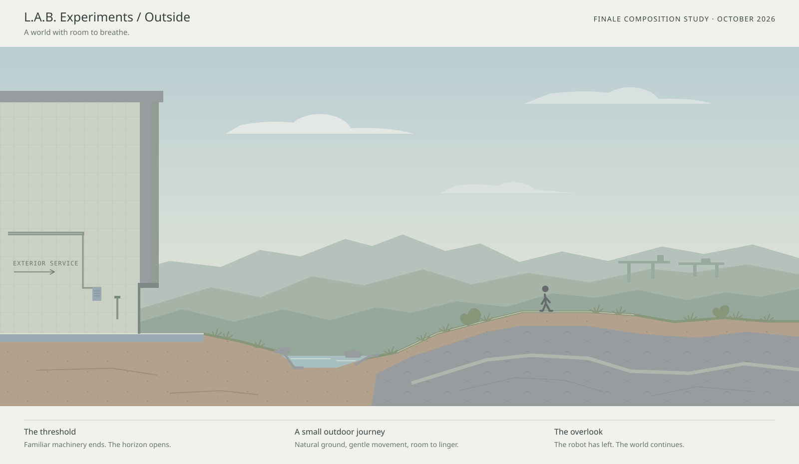

# Outside: outdoor terrain and sky

**Approved finale direction and implementation brief — October 18, 2026.**

The escape is the visual and emotional payoff of the
[L.A.B. campaign](jumping-campaign.md). This specifies an outdoor environment and
its playable reveal. Version-2 landscapes and Exit implement the playable escape;
the earlier Spelunk III route evidence and review limits are recorded in
[escape review](jumping-escape-review.md). Read alongside [level design](jumping-level-design.md),
[the current schema](jumping-levels.md), [contacts](jumping-physics.md), and
[lighting](jumping-lighting.md).

The concept is an art and composition study. Distances, slope angles, and jump
gaps in it are not a validated level layout. Its stage labels are documentation,
not text to put across the playable landscape. The October 26 in-game review
simplifies its background to flat blue sky and sparse clouds. That direction
supersedes the concept's distant ridges, transport span and layered atmosphere;
the game's core aesthetic remains simple and two dimensional.

## The payoff

After a campaign of enclosed courses, let the player emerge into a world with
depth and room to breathe. The familiar robot should feel small within it.
Natural ground continues beyond the facility and plants are alive. The robot has escaped; the landscape offers a
future without explaining everything that happened.

The scale comes from framing, distance, sound, and a meaningful change of place.
The exterior coda should offer roughly 20–40 seconds of relaxed first traversal
as an initial playtest target, with unlimited time to linger. Do not pad it with
empty walking to meet a duration. One short climb, a shallow crossing, and an
overlook can supply a complete little journey.

The first full outdoor reveal is required for all finishers. Preserve it in
campaign previews: use a cropped interior approach or a non-spoiling placeholder
for the locked finale tile. A hint of daylight or a plant earlier can build
anticipation, but save the open horizon and full landscape for escape.

## Reveal sequence

| Beat | Composition and movement | What the player understands |
| --- | --- | --- |
| Last service room | Familiar rectilinear structure, one final readable machinery problem, comfortable recovery. A restricted bright opening suggests a way out. | These learned skills now serve the robot's own goal. |
| Threshold | A real exterior opening with a flat landing. The roof and wall end. Sky and a distant horizon enter the normal camera view while the player walks. | The opening leads out of the building. |
| First open ground | Worn apron gives way to soil, low plants, and irregular rock. The robot remains at its established gameplay scale. | This is a continuing place the player can move through. |
| Small outdoor journey | A gentle rise and a contained shallow channel offer an ordinary route, a playful shortcut, and local recovery. The facility recedes behind. | The robot can use its training freely. |
| Departure | Safe ground and open sky continue to the right edge. Let the player linger or run offscreen to finish. | Escape is complete; the world extends beyond the campaign. |

Use continuous movement for the reveal. Avoid a hard cut, a compulsory camera
pan, or a result overlay at the threshold. Compose the view for the existing
camera first. Any authored camera changes need separate controls and framing
review; do not achieve scale by suddenly shrinking the character or hiding the
next landing. At the overlook, open sky should occupy roughly the upper half
of a normal landscape gameplay view. Review portrait views separately.

The playable coda begins before the ending dialog. Latch any service-course
score at the threshold and finish the story at the outdoor endpoint as described
in the [campaign brief](jumping-campaign.md#finale-outside). Keep control and
the option to linger until that endpoint. Completion presentation must preserve
the final view instead of immediately replacing it with the level picker.

## Terrain language

Build the exterior from authored polygons with broad, asymmetric silhouettes:
weathered outcrops, low banks, a shallow basin, and a long, gently rising ridge.
Use several considered changes of slope rather than a regular sawtooth or a
row of detached training platforms. The silhouette should still tell the player
where a foot can land and which edges can be gripped.

Retain the current material family. Earth supplies soil and cut banks; stone
supplies exposed rock; chalk can supply pale weathered seams; steel remains
recognizable at the apron and surviving service structures. Sparse sage ground
cover extends the palette into living vegetation. Grass is a thin decorative
fringe and a few clumps, not a thick second collision surface. Break it at rock,
metal, and paths so the actual supporting edge stays readable.

Terrain cut faces remain flat, quiet material areas with restrained grain and
edge relief. Place a few deliberate rock seams or earth strata within the solid
silhouette. Do not introduce realistic painted textures or a new grassy physics
material solely for this level. Shared collision, grip, shove, rope, and water
rules continue unchanged.

Make the ordinary line mostly walkable, with flat resting landings and an easy
way around the shallow crossing. A higher rock line may offer a running jump
and a satisfying landing. Falling from it returns to nearby usable ground.
The final coda has no required pressure-plate delivery, collectible quota,
medal gate, chase, or hidden restart state. Complete the last demanding work
before opening the view.

If water appears, give it a real basin and visible, tested banks. A nearby dry
line preserves relaxed access. Existing water remains present; no story switch
drains it. Decoration does not create tiny snags, imply climbable vines, or hide
an edge. Use existing geometry limits and split large forms into a small number
of simple authored pieces when necessary.

## Sky and distant landscape

Use one quiet daylight composition. A pale blue upper sky approaches warm
off-white near the horizon. Broad, sparse cloud shapes and two or three bands
of distant landscape provide scale. The sky becomes the largest simple shape
in the image; detail stays subordinate to the robot and the supporting ground.

| Element | Starting palette | Treatment |
| --- | --- | --- |
| Sky | `#bddbea` | Flat pale blue; the largest open area. |
| Clouds | `#f6f8f6` | A few long, simple shapes; no outlines or shading. |
| Ground cover | `#879579` | Sparse sage clumps outside the collision edge. |
| Soil / rock / steel | Existing terrain colors | Reuse the game's material fills and restrained relief. |

These colors are a starting art target, not a new lighting or surface-physics
contract. Check actual character contrast and adjust them after in-game review.
Keep the fixed daylight direction consistent with the current source above and
to the left. A visible sun disk is unnecessary. Avoid bloom, glare, lens flare,
dynamic exposure, colored local lights, or simulated atmospheric scattering.

Use the surviving service structures in the playable plane to suggest the old
world. Keep the sky quiet. Living vegetation supplies hope; explicit survivors
and the cause of collapse remain unresolved.

## Depth, indoor transition, and lighting

Render blue sky and sparse clouds behind playable geometry. They have no
collision, grip, collectible role, pressure load, shovebot cover, or shadow
caster geometry. Playable terrain supplies the landscape.

The sky is not an illuminated wall. Do not project the facility's terrain
shadows, contact-attachment halos, panel joints, or course grid onto clouds,
air, or distant hills. Indoor wall surfaces retain their own grid and lighting
where the building actually exists. The outdoor environment replaces the
backdrop only in authored exterior space; it must not turn every earlier level
or the enclosed service approach into a sky scene.

Keep sky, wall receivers, and playable geometry distinct in draw order and
lighting composition. Sky artwork does not change illumination of terrain or
actors. Cave back walls against the sky use light gray stone with a faint,
world-anchored texture and no grid or panel joints. Facility back walls retain
the standard course wall; the Indoor wall background also keeps its familiar
treatment. A small shared stone tile supplies the texture without per-frame
generation. Each terrain piece that
overlaps a Night region keeps the darker color throughout, including any part
extending into Day; pieces entirely in Day keep the lighter color. Daylight
spill lights the back wall and open space independently. Mixed-light levels
use a constant dark enclosing frame. Preserve the existing Day-mode material treatment and contact rules. Any additional
outdoor ground treatment must remain inside the terrain silhouette and must
not invent drop shadows onto empty air.

Keep the sky flat. Sparse cloud silhouettes scroll horizontally at 90% of the
terrain's speed, with their height controlled by the cloud baseline. No cloud drift, foliage sway,
birds, or particle system is required to deliver the initial landscape. If
ambient motion is later added, make it deterministic in previews and optional
for reduced motion, with no effect on simulation or visibility rules.

## Sound and restraint

Let the machinery sound fall away as the robot leaves. A sparse wind bed and
occasional distant natural sound can support the exterior without telling the
player what to feel. These require new audio support and assets; they are not
already supplied by the impact and mechanism sound system. Muted play must
still communicate the whole reveal. The pause and accessibility settings apply
throughout. Avoid mandatory speech or explanatory ending text over the horizon.

## Implementation boundaries

Terrain polygons and stone, earth, chalk, and steel materials supply the ground.
The default renderer still fills interior levels with the off-white course wall,
grid, and panels. An optional authored `environment` now supplies the landscape
and explicit cave/facility wall coverage. Ordinary goals retain doorway entry;
untimed `walk-off` and `overlook` goals supply exterior endpoints and a retained
final view. Exit uses `goal.kind: "bus"`: the bus is the goal inside the level,
visible during the normal playable approach. Walk into its left-side entrance
to board. There is no map-edge completion, automatic approach, or camera reveal.
The implied route crosses the platforming plane. The robot boards, then appears in
the rear window. Hold briefly before the bus travels directly away from the
camera, shrinking about its fixed visual center until the wheel bottoms align
with the flat ground line, which serves as the horizon. From that exact contact,
lower the bus briskly behind the line while it continues shrinking, so it
disappears while its rear silhouette is still readable. Keep the whole bus and
passenger together; the wheels disappear first and the roof last. There is no
upward travel or separate raised horizon. Draw no hill or rise. Leave the road surface
undrawn: no strip, edges, or perspective markings across the flat landscape.
Keep the art flat and restrained, using the actual
player rig. Save completion before the scene, allow pause and skip, and show the
ending panel after departure. Keep the actual level, terrain, lighting, and
camera in view throughout. The development preview at `/lab/ending-review`
starts on Exit's final approach with normal controls and also offers a separate
departure playback mode. Neither mode records campaign progress.

The initial implementation supplies the following reusable support:

- An authored environment/background choice with an interior default and a
  deliberate interior-to-exterior boundary, preserving existing files.
- Blue sky and sparse clouds, explicit wall coverage, correct lighting
  receivers, and artwork for sparse outdoor ground cover.
- A consistent scene in play, studio, saved files, and thumbnails, with the
  editor grid available as an editing overlay rather than a wall painted in sky.
- An untimed outdoor finish and resumable exterior progress. Spelunk III is
  untimed throughout; a separate threshold that latches a timed approach's score
  is still future work.

The supported schema and compatibility strategy are documented in
[level files](jumping-levels.md#landscapes-caves-and-outdoor-finishes-version-2).
Keep environment settings in authored data, not a special case for a finale
filename or a global renderer theme change. Validate parsing, round trips,
editor controls, thumbnails, lighting, and existing-file defaults together.

## Acceptance and open playtest work

The panorama illustrates the intended direction; the final route, gameplay-scale composition,
camera framing, timing, sound, and emotional impact remain unverified until a
working level is played. Do not assign medal times from the concept image or
the initial coda-duration target.

- Play the full approach, reveal, outdoor journey, and finish from a fresh
  campaign run with ordinary controls and no optional-area medals.
- Confirm the first reveal reads as genuinely outside at normal speed and muted,
  without a lore paragraph, an abrupt camera zoom, or a premature result dialog.
- Review gameplay at landscape, narrow portrait, and low-detail settings. Keep
  the robot, recoveries, natural support edges, and horizon legible.
- Walk both lines, miss the optional jump, stop at the threshold and overlook,
  turn back, pause, restart, and reload the saved coda. Check that score stays
  latched, input remains usable, and campaign completion happens only at finish.
- Check sky and distant scenery receive no wall shadows, contact halos, grid,
  collisions, or gameplay effects, and that the interior keeps its proper wall.
- Compare studio, thumbnail, saved/reopened, and playable views. Confirm old
  indoor files render and round-trip unchanged; measure rendering performance
  against the existing lighting budgets.
- Run the level validator once a real JSON map exists. Retain normal-speed human
  review of pacing and the payoff in addition to any automated route checks.
